# CWatM GUI — Documentation and User Manual

## Version 1.14

A graphical user interface for the **Community Water Model (CWatM)** developed by
IIASA. The application lets you load, edit, validate and run CWatM settings files,
inspect the model set-up on a map, edit the reservoir/crop Excel workbook, and
visualise the model results — all without leaving the GUI. A guided course, the
**CWatM Academy**, introduces new users step by step.

> The screenshots in this manual were produced with the example set-up
> `Danube_1min/Morava` (`settings_morava_1min.ini`) and its output folder, plus a
> scenario of it with deeper soil (`soildepth_factor = 1.5`) for the comparison views.

---

## Table of Contents

1. [Introduction](#1-introduction)
2. [Installation and Requirements](#2-installation-and-requirements)
3. [Getting Started](#3-getting-started)
4. [User Interface Overview](#4-user-interface-overview)
5. [Menus and Keyboard Shortcuts](#5-menus-and-keyboard-shortcuts)
6. [Editing Settings](#6-editing-settings)
7. [Gauges, Mask and PathOut Checks](#7-gauges-mask-and-pathout-checks)
8. [Check settingsfile](#8-check-settingsfile)
9. [Running the Model](#9-running-the-model)
10. [Show Basin](#10-show-basin)
11. [Check Data](#11-check-data)
12. [Excel Editor (Crops / Reservoirs)](#12-excel-editor-crops--reservoirs)
13. [Result Analysis](#13-result-analysis)
14. [CWatM AI (NotebookLM)](#14-cwatm-ai-notebooklm)
15. [Configuration and Appearance](#15-configuration-and-appearance)
16. [CWatM Academy](#16-cwatm-academy)
17. [CWatM Account, Badges and the Shop](#17-cwatm-account-badges-and-the-shop)
18. [Building the Executable and Installer](#18-building-the-executable-and-installer)
19. [Troubleshooting](#19-troubleshooting)
20. [Versioning](#20-versioning)

---

## 1. Introduction

CWatM is a large-scale hydrological model. Its behaviour is driven by a plain-text
**settings file** (`.ini`) that points at input maps/meteo, defines the simulation
period, and switches processes on/off. This GUI wraps the whole workflow:

- a **syntax-highlighted editor** for the settings file with folding, bookmarks,
  change tracking and duplicate-key detection;
- convenience fields for the **dates, PathOut, MaskMap and Gauges** that write back
  into the settings automatically;
- **validation** tools (gauge-in-mask, PathOut existence, missing-file checks,
  Check Data);
- a one-click **Run** that streams the model output live with a progress clock and a
  discharge sparkline — plus **Windowed** runs in parallel, **Batch** runs of many
  scenarios, and a **Journal** of every past run;
- an **Excel editor** for the reservoir/crop workbook;
- **map and plot** windows to inspect the basin and the results, including several
  views of the **water balance** (sunburst, Sankey, chord, weekly and annual fluxes, the
  full balance of every part of the water cycle);
- a **CWatM AI** chat that answers questions about CWatM from Google NotebookLM;
- the **CWatM Academy**, a guided ten-level introduction with a small map game;
- an optional **CWatM account** with points, river badges, a leaderboard and a Shop.

Everything works without an account: every skill level (Beginner / Advanced / Expert)
and the whole Academy are free.

---

## 2. Installation and Requirements

**Requirements**: Python 3.10+ (3.12 recommended), PySide6 (incl. QtWebEngine), NumPy,
pandas, xarray, rasterio, netCDF4, folium, plotly, openpyxl, requests, and the CWatM
model package. The optional **CWatM AI** chat needs `notebooklm-py` (+
`playwright` for the login); the optional **MODFLOW** coupling needs `flopy` + `xmipy` (and the
MODFLOW 6 `libmf6` library); the optional **CWatM account** uses `supabase` + `keyring`.
All pinned versions are in `requirements.txt`.

```bash
pip install -r requirements.txt          # runtime (pinned)
pip install -r requirements_build.txt    # + PyInstaller, only to build the exe
pip install -r requirements_dev.txt      # + pytest, only to run the tests
python cwatm_gui.py                       # run from source
```

Do **not** install a separate GDAL wheel — rasterio ships its own GDAL.

A pre-built **`CWatM_GUI.exe`** (one-folder build) or the per-user **installer**
(`CWatM_GUI_Setup.exe`) can be run with no Python installation. See
[Building the Executable and Installer](#18-building-the-executable-and-installer).

**Linux**: the GUI runs from source (the exe and installer are Windows-only). Start it
with `./gui.sh`; `./gui.sh --check` diagnoses a missing library. The full guide —
system packages, the virtual environment, remote X displays (X2Go, VNC, Xming, WSLg) and
troubleshooting — is in `cwatm_gui_linux.md` in the GUI folder.

---

## 3. Getting Started

1. Start the application (`python cwatm_gui.py` or `CWatM_GUI.exe`). The window opens
   **maximised**.
2. **File ▸ Load .ini** (Ctrl+O) and pick a settings file — or drag a `.ini`/`.txt`
   file onto the window, or start `CWatM_GUI.exe <settings.ini>`.
3. The settings appear in the editor on the right; the date / PathOut / MaskMap /
   Gauges fields on the left are filled in from the file.
4. Edit as needed, then **RUN CWATM ▸ Run CWATM** (Ctrl+R).

New to CWatM? Click **CWatM Academy** in the menu bar — it walks you through loading,
checking, running and analysing a model in ten short levels ([§16](#16-cwatm-academy)).
The **skill level** button next to the editor (Beginner / Advanced / Expert) decides how
much of the settings file and of the menus you see; start with Beginner and switch up
when you need more.

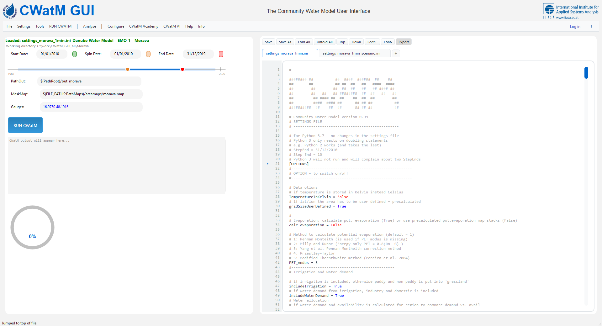

---

## 4. User Interface Overview

- **Banner** (top): the CWatM icon, the title *"The Community Water Model User
  Interface"*, and the IIASA logo. It can be hidden with **Preferences ▸ Display ▸ Show Header**
  to give the panels more room.
- **Menu bar** (directly below the banner): the whole application is menu-driven — see
  [Menus](#5-menus-and-keyboard-shortcuts). Its right corner holds the **Shop** button
  (once you own the Breg badge), the **account** button (*Log in* or *your name · points*)
  and **⋮** (Preferences).
- **Left panel**: the Start/Spin/End dates (with an optional 📅 calendar picker and a
  draggable timeline), PathOut, MaskMap and Gauges fields, the **RUN CWATM** button
  with a live *changed-fields* hint and warning label, the circular **progress clock**
  and the live **discharge sparkline**.
- **Right panel**: the **settings editor** (plain-text with syntax highlighting, a
  line-number gutter with fold markers, and bookmarks), with the **tab bar** above it —
  one tab per open settings file, so several can be open at once
  ([§6](#6-editing-settings)). Above the editor sit the navigation buttons (Fold/Unfold,
  Top/Down), **Font+ / Font-**, and the colour-coded **skill-level** button (green
  Beginner, blue Advanced, gray Expert — click to cycle).
- **Output box** (below): a read-only, copyable log of the model run, with the
  progress clock and sparkline beneath it.

---

## 5. Menus and Keyboard Shortcuts

Menu bar (left → right): **File · Settings · Tools · RUN CWATM ·
Configure │ Analyse │ CWatM Academy · CWatM AI · Help · Info**. Recently opened files
are listed directly in the **File** menu, and **CWatM Academy** and **CWatM AI** are
clickable buttons, not dropdowns.

Some entries depend on the **skill level**: *Beginner* hides the advanced ones (marked
*Adv.* below), and a few are shown to *Expert* only. Nothing is removed — switch the
level and they come back.

Inside the longer menus the items are grouped under **bold section headers** (for
example Settings has *View · Find & Replace · Edit · Bookmarks & Changes · Check &
Compare*; Tools has *Basin & Gauges · Outputs · Setup & Data*).
**Configure** holds a single item, *Preferences…*, which opens the settings window
described in [§15](#15-configuration-and-appearance); the **⋮** button on the far
right of the menu bar opens the same window.

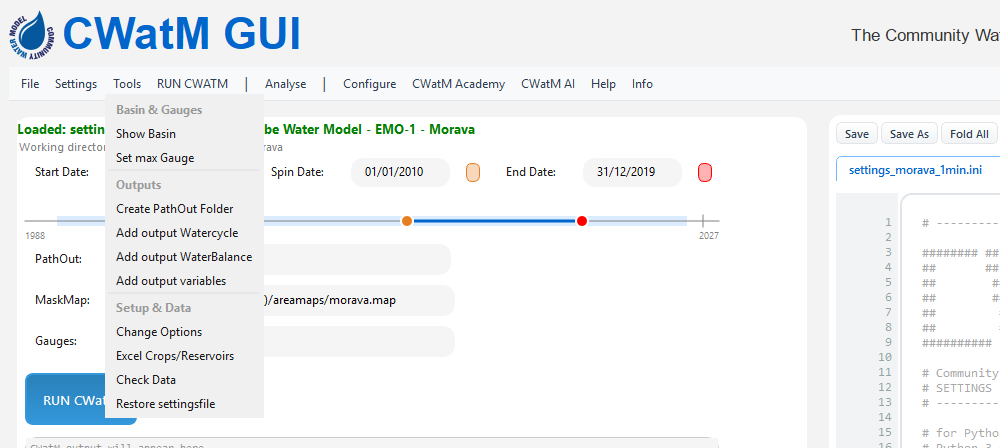

| Menu | Item | Shortcut | Action |
|------|------|----------|--------|
| File | Load .ini | **Ctrl+O** | Load a settings file |
| File | Reload | **Ctrl+L** | Reload the current file from disk |
| File | Save .ini | **Ctrl+S** | Save to the current file |
| File | Save As | **Ctrl+Alt+S** | Save to a new file |
| File | Change Working Dir | — | Pick the folder that relative paths in the settings resolve against |
| File | (recent files) | — | Up to **6** recently opened settings files, listed directly in the File menu between Save As and Exit |
| File | Exit | — | Quit (prompts if there are unsaved changes) |
| Settings | Fold All / Unfold All | **Alt+0 / Alt+Shift+0** | Collapse / expand all sections |
| Settings | Top / Down | **Alt+T / Alt+D** | Jump to start / end of the file |
| Settings | Find | **Ctrl+F** | Open the Find & Replace window on the Find tab |
| Settings | Find next / Find previous | **F3 / Shift+F3** | Repeat the last search forwards / backwards (wraps) |
| Settings | Replace | **Ctrl+H** | Open the Find & Replace window on the Replace tab |
| Settings | Undo / Redo | **Ctrl+Z / Ctrl+Y** | Undo/redo editor **and** left-window field changes |
| Settings | Toggle Bookmark | **Ctrl+F2** | Bookmark the current line (orange gutter dot) |
| Settings | Next / Previous Bookmark | **F2 / Shift+F2** | Jump between bookmarks (wraps) |
| Settings | Clear all Bookmarks | **Ctrl+Shift+F2** | Remove every bookmark |
| Settings | Goto last change | **F5** | Jump to the most recently changed line |
| Settings | **Check settingsfile** | **F4** | **Toggle:** flag missing files/paths (relabels to *Clear checking*); press F4 again to clear — see [§8](#8-check-settingsfile) |
| Settings | Compare settings | — | Side-by-side diff of two settings files (differing lines orange, synced scrolling, Next/Previous Diff); both sides stay aligned while you edit. With several tabs open, the **active** tab and the tab next to it are preloaded |
| Settings | **Compare Tab** | **F8** | *(Expert only)* **Toggle:** colour every line that differs from the neighbouring tab light green, **in both tabs**, right in the editor; F8 again clears it — see [§6](#6-editing-settings) |
| Tools ▸ *Basin & Gauges* | Show Basin | — | Basin viewer on an OSM map — see [§10](#10-show-basin) |
| Tools ▸ *Basin & Gauges* | Set max Gauge | — | Set Gauges to the largest-upstream point in the mask |
| Tools ▸ *Outputs* | Create PathOut Folder | — | Create the resolved PathOut directory (CWatM does not create it) |
| Tools ▸ *Outputs* | Add output Watercycle | — | *(Adv.)* Add `OUT_TSS_AreaSum_Daily = WaterCycle` — the input of the Watercycle views |
| Tools ▸ *Outputs* | Add output WaterBalance | — | *(Adv.)* Add `OUT_TSS_AreaSum_Daily = WaterBalance` — the input of Full Waterbalance |
| Tools ▸ *Outputs* | Add output variables | — | Insert an output variable that fits the current `[OPTIONS]` on an `OUT_…` line — grouped by topic, searchable by name/unit/description, **✓** on what the file already writes, and array variables ask which index (e.g. *1 - grassland*) |
| Tools ▸ *Setup & Data* | Change Options | — | *(Adv.)* Boolean `[OPTIONS]` window |
| Tools ▸ *Setup & Data* | **Excel Crops/Reservoirs** | — | *(Adv.)* Open the settings Excel workbook — all its sheets (*Crops*, *Reservoirs*, *Reservoirs_downstream*, …) on tabs below the table — see [§12](#12-excel-editor-crops--reservoirs) |
| Tools ▸ *Setup & Data* | Check Data | — | *(Adv.)* Validate the settings by running CWatM's data checks (in the background, with its output and a sortable/filterable result table) |
| Tools ▸ *Setup & Data* | Restore settingsfile | — | *(Adv.)* Open a CWatM output `dis*.nc`: summary card + all its metadata, **preview** the settings file stored inside, **compare** it with the loaded one, restore it to a new file, list **and check** its input files |
| RUN CWATM | Run CWATM | **Ctrl+R** | Run / stop the model |
| RUN CWATM | Run CWatM + error message | — | The same run with CWatM's `-e` flag: an error message names the code line where the error happened |
| RUN CWATM | **Journal of Runs** | — | *(Adv.)* Table of past runs; open results, show the log, reload settings, re-run, compare settings or results — see [§9](#9-running-the-model) |
| RUN CWATM | Windowed Run CWatM | — | *(Adv.)* *Run CWatM in a separate window* — its own process, several in parallel — see [§9](#9-running-the-model) |
| RUN CWATM | **Batch Run…** | — | *(Adv.)* Run many scenarios from the loaded file (base .ini + per-row overrides, N in parallel) — see [§9](#9-running-the-model) |
| RUN CWATM | Create batch | — | *(Expert only)* Write a Windows `.bat` that runs the current settings file without the GUI |
| Configure | **Preferences…** | **Ctrl+,** | The window holding **every** GUI setting, on seven pages — see [§15](#15-configuration-and-appearance) |
| _(menu bar)_ | **⋮** | — | The button on the far right of the menu bar — opens the same Preferences window |
| Analyse | Open PathOut Folder | — | Open the resolved PathOut directory |
| Analyse | **Output Explorer** | — | Browse PathOut; double-click a result to open the right viewer |
| Analyse | Timeseries | — | Plot a result `.csv` (+ Load observed / metrics, range slider, Flow duration / regime) |
| Analyse | NetCDF | — | Show a result `.nc` on a map (+ Fast/Total timeserie, Compare A−B, mean/percentile, Save as .tif) |
| Analyse ▸ Watercycle | Watercycle | — | Water-balance **sunburst** (visible at every level) |
| Analyse ▸ Watercycle | Flow Diagram | — | *(Adv.)* Water-balance **Sankey** |
| Analyse ▸ Watercycle | Chord Analysis | — | *(Adv.)* The same flows as a **chord diagram** (experimental) |
| Analyse ▸ Watercycle | Mean Weekly Fluxes | — | *(Adv.)* Mean seasonal cycle, week by week, one panel per component (experimental) |
| Analyse ▸ Watercycle | Annual bars | — | *(Adv.)* One stacked column per complete year |
| Analyse | Full Waterbalance | — | *(Adv.)* Balance table + sunbursts of **every** part of the water cycle (needs the WaterBalance csv) |
| CWatM Academy | (button) | — | The guided introduction — see [§16](#16-cwatm-academy) |
| CWatM AI | (button) | — | Chat about CWatM, answered by Google NotebookLM — see [§14](#14-cwatm-ai-notebooklm) |
| Help | CWatM GUI Documentation / Features / **FAQ** | — | This manual / the feature tour / common questions & troubleshooting |
| Help | CWatM account privacy | — | The privacy notice of the optional CWatM account |
| Help | CWatM Homepage | — | Open the CWatM website in your browser |
| Info | About CWatM | — | Versions of the GUI and of the bundled CWatM model (GitHub branch + commit) |
| Info | World Map | — | Where CWatM has been run (anonymous counts), and the users who chose to show their location — see [§17](#17-cwatm-account-badges-and-the-shop) |
| Info | Leaderboard | — | *(only while logged in)* Ranking of the users who opted in |

While CWatM is running the GUI stays fully usable (you can analyse results, browse the
ledger, chat with CWatM AI, …) — only **Save** is disabled, because the run uses the
file on disk. **Save As** still works.

---

## 6. Editing Settings

The editor **is** the settings file at all times — what you save is exactly what you
see. Highlights:

- **Syntax highlighting**: section headers bold, comments grey, `True`/`False` in
  blue/red. Hovering a CWatM variable name shows its unit / description.
- **Folding**: double-click a `[SECTION]` header (or the ▾/▸ gutter marker) to
  collapse it; folded sections are still saved and searched.
- **Bookmarks**: mark lines (Ctrl+F2 or click a line number) and jump with F2 /
  Shift+F2. Preferences ▸ Editor & Dates ▸ *Bookmark Change* can auto-bookmark changed lines.
- **Change tracking**: lines that differ from the last save get a **light-blue**
  background; **Goto last change** (F5) jumps to the most recent edit.
- **Duplicate keys** are drawn in a **strong red** — CWatM flattens all sections into
  one dictionary, so a repeated key silently overrides the earlier value. (This is a
  deeper red than the light-red used by Check settingsfile for a missing file.)
- **Left-window fields** (dates, PathOut, MaskMap, Gauges) auto-apply into the
  settings after a short debounce (without saving to disk); a blue hint right of RUN
  CWATM lists which fields differ from the file. Undo/Redo cover these too.
- **Date fields**: pick the Start/Spin/End dates with a 📅 calendar popup or drag them
  on the **timeline** below the fields (the light band is the meteo-forcing coverage).
  Both are toggled in **Preferences ▸ Editor & Dates ▸ Web-style date picker / Date timeline**.
- **Change Options** (Tools) lists the boolean `[OPTIONS]` flags as tick boxes, grouped
  by topic, with a **filter box**, a **Changed only** tick, a **dot** on everything you
  changed and **Revert all** to undo the lot. Hover the small **ⓘ** beside an option to
  read what it controls and what True/False mean. **Add option…** offers switches CWatM
  understands that your file does not define yet. The window is not modal, so the editor
  stays visible; ticking a box is a single **Ctrl+Z** away, and a comment written after
  the value is preserved.

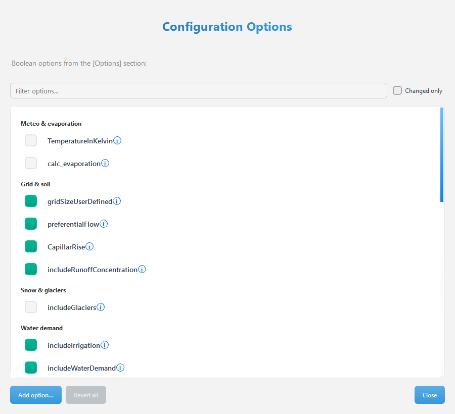

### Several settings files at once (tabs)

The bar above the editor holds **one tab per settings file**, so a base run and its
variants can be open side by side. A loaded file — from **File ▸ Load .ini**, the recent
files, or dropped onto the window — goes into the **active** tab; the small **+** right
of the last tab opens an empty one for the next file.

- **The active tab is what everything works on**: RUN CWATM, the date / PathOut /
  MaskMap / Gauges fields, Check settingsfile, Show Basin, Check Data, Compare, the Excel
  editor and the Analyse windows all use the file of the tab you are looking at.
  Switching tabs swaps the whole left panel with it.
- **Each tab keeps its own** undo history, bookmarks, folded sections, changed-line
  highlights and Check-settingsfile marks. A tab with unsaved edits shows a **`*`**;
  **Save** only ever writes the active tab, and on exit you are asked once per unsaved
  file.
- **The same file can only be open once.** Loading a file another tab already has brings
  you to that tab, and *Save As* onto another tab's file is refused — two tabs on one
  file would mean two versions of the text, and the second save would quietly discard the
  first tab's work.
- **Close** a tab with the **✕** that appears on it under the mouse; **reorder** tabs by
  dragging them.

**Right-click a tab** for:

| Item | What it does |
|------|--------------|
| **Delete Tab** | Close it (asking about unsaved changes). Deleting the last tab empties it instead. |
| **Copy Tab** | Write what the tab currently shows — unsaved edits included — to a new file in the same folder (`settings.ini` → `settings_2.ini`) and open it in a new tab next to it. |
| **Run CWatM** | Run **this tab's** settings file (as saved on disk) in its own **Windowed Run** window — independent of the main run and of the other tabs, so a second scenario can run beside the first. See [§9](#9-running-the-model). |
| **Link scrolling** | Scroll this tab and the **previous** one together and keep the **same sections folded** in both, so switching between them lands you on the same lines. Greyed out on the first tab; ticking several in a row links them all. |

Two comparisons use the tabs: **Settings ▸ Compare Tab (F8)** colours every line that
differs from the neighbouring tab light green **in both tabs** (F8 again clears it,
nothing is written), and **Settings ▸ Compare settings** opens with the active tab left
and the neighbouring tab right.

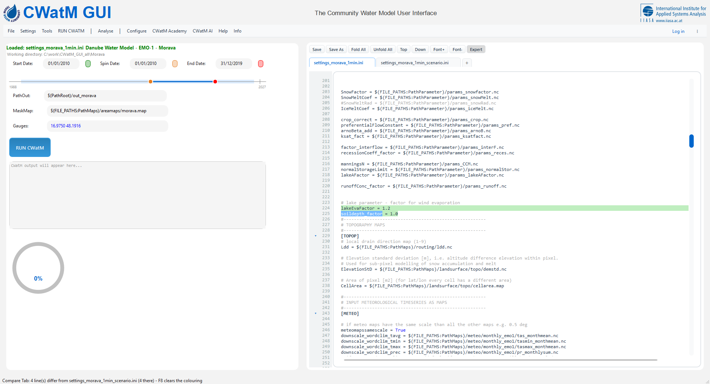

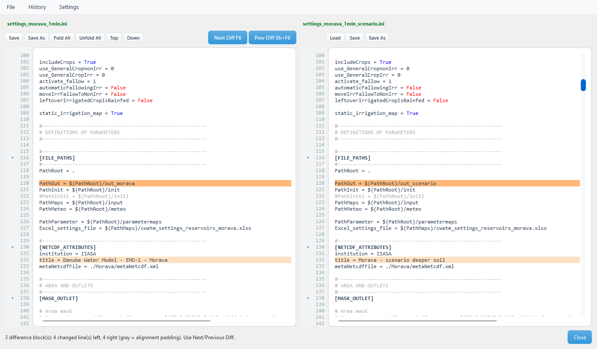

Tabs belong to the **Expert** skill level and can be switched off in **Preferences ▸
Editor & Dates ▸ Use Tabs** (on by default) — that hides only the bar, never the open
files. With **Load previous settings at start** (Preferences ▸ Startup & Model) ticked,
all open tabs are reopened on the next start.

### Adding output variables

**Tools ▸ Add output variables** picks what CWatM should write, without looking anything
up in the documentation. Opening it **jumps the editor to the end of the file** (as
*Settings ▸ Down* does), because `[OUTPUT]` is the last section — the `OUT_…` lines you
are about to add to are then on screen, and so is the cursor a click inserts at.

- Only the variables that **fit your `[OPTIONS]`** are listed (no glacier output when
  glaciers are off), **grouped by topic** — snow, meteo, evaporation, soil, groundwater,
  lakes, routing, water demand, crops, balance totals, static maps.
- The **filter box searches the unit, long name and description as well as the name**,
  so *evapo* finds `actualET`.
- A **✓ (green, bold)** marks every variable your settings file already writes; the
  tooltip names the `OUT_…` keys and lines it appears on, and clicking it again removes
  it. **Only variables already in the settings file** turns the list into an overview of
  your outputs.
- Variables marked **`[index]`** are arrays — `actualET` is calculated per land cover and
  must be written `actualET[1]`. You are asked which one **by name** (*1 - grassland*,
  *0,2 - top soil layer, irrPaddy*), so an index can no longer be wrong or forgotten.
  Check settingsfile flags a wrong index from the same table.
- **Left-click** inserts at the editor cursor (on an `OUT_TSS_…` / `OUT_MAP_…` line);
  **right-click** chooses output type and time step and creates the key if needed.
- By default only the recommended (high-priority) variables are shown; **Load all
  Variable** shows all ~580. What your file already uses is listed either way, and the
  list re-reads the file whenever you come back to the window — there is no Refresh
  button.

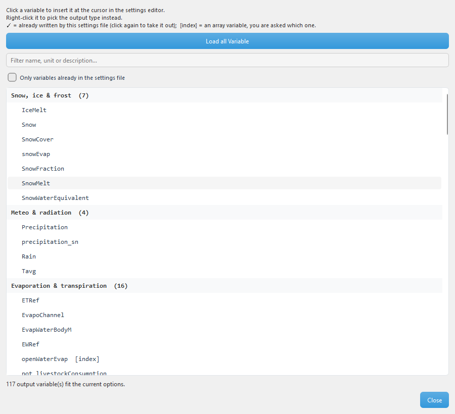

---

## 7. Gauges, Mask and PathOut Checks

The GUI continuously validates the **live** field values (not just the saved file):

- **Gauge-in-mask**: the Gauges field text is **blue** when every gauge lies inside
  the basin, **red** if any is outside. It works for a file-based MaskMap *and* a
  coordinate-based one (the basin is generated on the fly).
- A **warning label** right of RUN CWATM shows problems in red, e.g. *"Gauge is not
  inside the basin!"* or *"PathOut does not exist!"*.
- **Tools ▸ Set max Gauge** places the gauge on the largest-upstream cell in the mask.
- **Tools ▸ Create PathOut Folder** creates the resolved output directory.

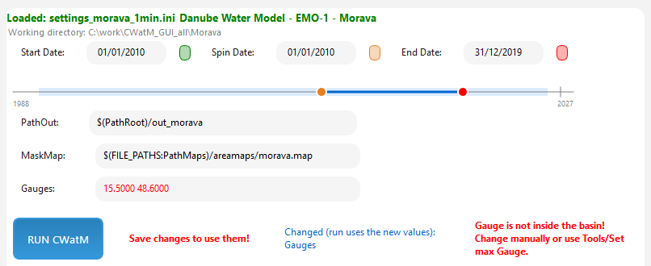

---

## 8. Check settingsfile

**Settings ▸ Check settingsfile** (F4) scans the settings as shown in the editor and
checks every value that can be identified as a **filename or path** (a `$(…)`
placeholder, a data-file extension such as `.nc/.tif/.map/.txt/.csv/.xlsx`, or an
absolute path). Placeholders are resolved from the other settings entries. **It is a
toggle** — after a scan the menu item becomes **Clear checking**; press **F4** again to
remove all the marks and bookmarks (your own bookmarks are kept).

Lines are colour-coded by severity:

- **Red + bookmarked** — the file/folder **does not exist** at all. Press **F2 /
  Shift+F2** to jump between them. Keys whose name starts with **`path`**
  (`PathRoot`, `PathOut`, `PathMaps`, …) are treated as **directories** and checked
  strictly.
- **Light orange, no bookmark — wrong extension.** The file exists but under a
  **different raster extension** than written (e.g. the value says `cellarea.map` but
  `cellarea.nc` is on disk). A likely typo, not a hard error — so it is a soft mark.
- **Dimmed light orange, no bookmark — not read.** A missing file that CWatM will not
  actually read is not flagged as an error, only dimmed. This covers:
  - a section whose `[OPTIONS]` switch is **off** (e.g. `[GLACIER]` with
    `includeGlaciers = False`), or an individual key whose gating option is off;
  - a **value-gated** file, e.g. `averageDischarge` / `averageBaseflow` are read only
    when `swAbstractionFrac < 0`; with `swAbstractionFrac ≥ 0` a missing one is dimmed;
  - **groundwater-MODFLOW input** (`PathGroundwaterModflow*` and the files routed
    through it — `modflow_basin`, `topo_modflow`, …), which is normally preprocessed
    and optional.

**Semantic checks** run too: the simulation **date ordering**
`StepStart ≤ SpinUp ≤ StepEnd`; **option dependencies** — an option switched **on** whose
required keys are missing **or point to a non-existent path** (e.g.
`modflow_coupling = True` with a bad `path_mf6dll`) — the **option line itself** is
marked, not just the path line; the validity of every `OUT_…` **output key and its
variable names**, including the **index** an array variable needs (`actualET` →
`actualET[1]`, the same table *Add output variables* offers the indices from); and
whether the run window fits inside the **meteo forcing** data's
time range (reading the precipitation/temperature NetCDFs' time axis) — catching the
common *"StepEnd is past my forcing data"* crash **before** you waste a run.

A concise summary — **only the problem lines**, with each category explained — is
written to the output box.

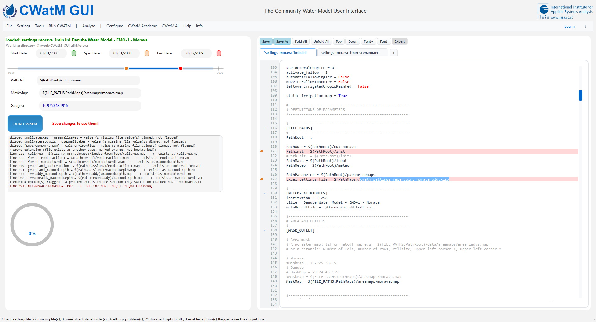

---

## 9. Running the Model

**RUN CWATM ▸ Run CWATM** (Ctrl+R) starts the model; the same item becomes **Stop**
while it runs.

- Output streams **live** into the output box (per-timestep date + discharge
  overwrite a single line, as on the console); errors show in dark red.
- The **progress clock** shows the percentage plus **elapsed** and estimated
  **remaining** time, frozen as *run time* / *failed after* / *stopped after* at the
  end.
- **Run mode**: the model runs in its **own OS process** — Stop is an immediate kill
  (works even if the model hangs in C code) and a model crash cannot take the GUI down.
- **Live discharge sparkline**: next to the progress clock, a small plot of the
  discharge at the first gauge over the last ~3 months. The trace is brightest on the
  right (newest) and fades out towards the left. Every so often a little animal
  (Preferences ▸ Display ▸ **Select animal**) swims along the trace.
- **Output-box log file** (Preferences ▸ Output): the run log can be appended to a file
  (`<PathOut>/cwatm_out.txt` by default, or a custom path).
- **Run CWatM + error message** runs the same model with CWatM's `-e` flag: when it
  fails, the error message also shows the code lines where the error happened — useful
  when reporting a problem.
- **Output entries are checked before the run starts**: an `OUT_…` entry CWatM would
  refuse (anything but a variable name with numeric indices) stops the run at once,
  with the lines named, instead of failing after the model has been set up.

Every finished run — main, Windowed or Batch — is recorded in the **Journal of Runs** (below).

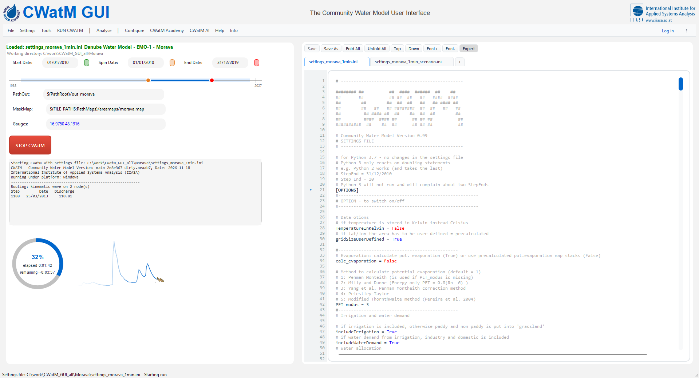

### Create batch *(Expert)*

**RUN CWATM ▸ Create batch** writes a Windows `.bat` file that runs the **current
settings file** exactly the way Run CWATM does — the same model, from the same working
directory — but without the GUI, e.g. to start it on another machine or from a
scheduler. You choose where to save it (suggested name `Run_<settings>.bat`), and the
folder opens afterwards. The batch runs the file **on disk**, so unsaved edits are
pointed out first.

### Windowed Run CWatM

**RUN CWATM ▸ Windowed Run CWatM** opens a small **separate window** that runs CWatM on
a settings file in its **own process**, independent of the main window — so the main
GUI stays fully usable and **several Windowed Run windows can run at once** (e.g. to run
different settings files in parallel).

Each window opens **pre-loaded** with the settings file currently open in the main
window (shown in **bold green**); a **Load** button picks a different `.ini`, **Use
current** takes whatever the main window has loaded now, and an `.ini` can be dropped
onto the window. Press **Run CWatM** (it toggles to **Stop CWatM** while running) and the
run streams into that window's own output box, with a progress bar and elapsed/remaining
time; the run is recorded in the Journal of Runs like any other.

The **⚙ gear button** (right of Load) chooses **which CWatM** the window runs:
- **Use predefined** (default) — the model installed with the GUI, e.g.
  `C:\Apps\CWatM_GUI\_internal\CWatM_model.exe`;
- **User defined** — type (or **Browse…** for) another model: a `CWatM_model.exe`
  (`P:\watmodel\CWatM_model.exe`), a CWatM folder, a `run_cwatm.py`, or a whole command
  line such as `python P:\watmodel\cwatmpublic\develop\run_cwatm.py`. The settings file
  and the flag `-l` are added at the end; the green line below the field shows the command
  that will run, or why it cannot.

Nothing changes until you press **Apply** (enabled only for a real change and a
command that can run); **Close** discards what was not applied. The applied choice is
remembered, and it applies **only to Windowed Run CWatM** — unless you also tick the red
**"WARNING: Expert only. Use this model for the main RUN CWATM too"** (only possible with
User defined): then the main **RUN CWATM** button and **Run CWatM + error message** run
that model as well (with `-l`, resp. `-l -e`). The main window then shows
**⚠ User-defined CWatM: …** in red right of the RUN button, and the output box names the
model at the start of every run. Untick the box to get the standard CWatM back. Batch
Run always uses the predefined model. A user-defined model that is not the GUI's own
`CWatM_model.exe` reports success by its exit code, and its progress bar follows the
date of the per-timestep output line.

Two other places open the same window on a file of their own: a **right-click on a
settings tab ▸ Run CWatM** ([§6](#6-editing-settings)) runs that tab's file, and the
Journal of Runs' **Re-run** starts a past run again.

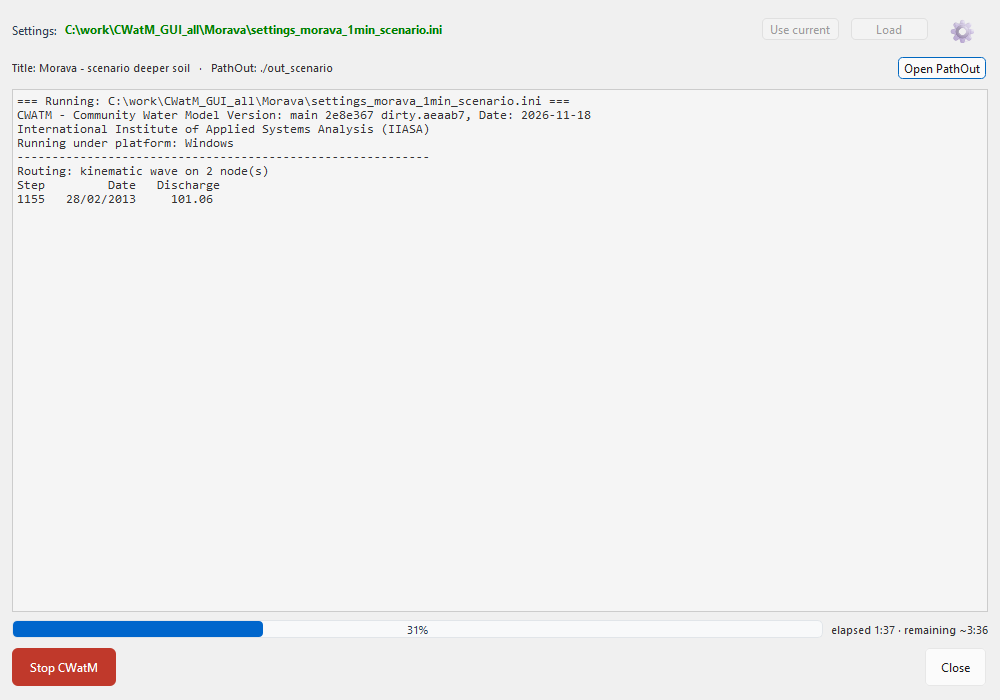

### Batch Run

**RUN CWATM ▸ Batch Run…** runs **many scenarios** derived from the loaded settings
file. A **table** where each row is a scenario:

- a **Scenario** name and its own **PathOut** (defaulted to `<base PathOut>_<name>` so
  runs don't collide; the folder is created automatically);
- per-scenario **key = value overrides** — add a column with **Add key column**, which
  takes the key from the settings-editor's **cursor line** (put the cursor on the key
  you want to vary, e.g. `SnowMeltCoef`, then press the button).

Set **Parallel runs** (1 = sequential) and press **▶ Run all**; each row shows a live
**Progress / Status**. **Stop all** kills everything; **Clear** starts fresh. The
scenario table is **remembered** between sessions. Each finished scenario is written to
the Journal of Runs.

For a **parameter sweep** (sensitivity analysis / manual calibration), press **Sweep…**
and enter one `key: values` line per parameter — the values as a **list**
(`SnowMeltCoef: 3.5, 4.0, 4.5`) or a **range** `min:max:step` (`3.5:4.5:0.5`). Several
keys generate the **full grid** of combinations; the rows (with their own PathOut per
combination) are filled in for you.

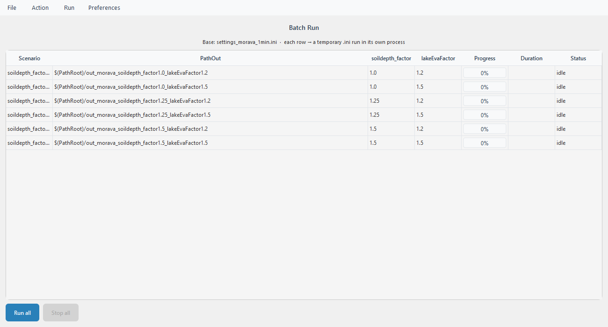

### Journal of Runs

**RUN CWATM ▸ Journal of Runs** is a sortable, filterable table of your **past runs**
(main, Windowed and Batch) — time, Title, PathOut, duration, success and last discharge.
Runs **still in progress** appear live at the top, the scenarios of one Batch Run fold
into **one row**, and the last column is a **Note** you can type into. Select a run and
use the **File / Action / Clean** menus or the right-click menu:

- **Open results** — its PathOut in the Output Explorer (or the folder itself);
- **Show log** — the run's output log;
- **Load settings** — reopen its settings file in the main window;
- **Re-run** — start it again in a Windowed Run window;
- **Compare settings** — mark **two** runs (Ctrl/Shift+click) and diff the settings each
  one actually used (a snapshot is kept per run, so the diff is correct even if you edit
  the file later); **Compare results** overlays the same result `.csv` of
  the marked runs in one Timeseries plot;
- **Delete entry** / **Clear Journal**, and **Export CSV** of the table.

Where the ledger is stored and how long runs are kept are set in **Preferences ▸ Run
History** (default: keep 60 days under
`%LOCALAPPDATA%\CWatM_GUI`).

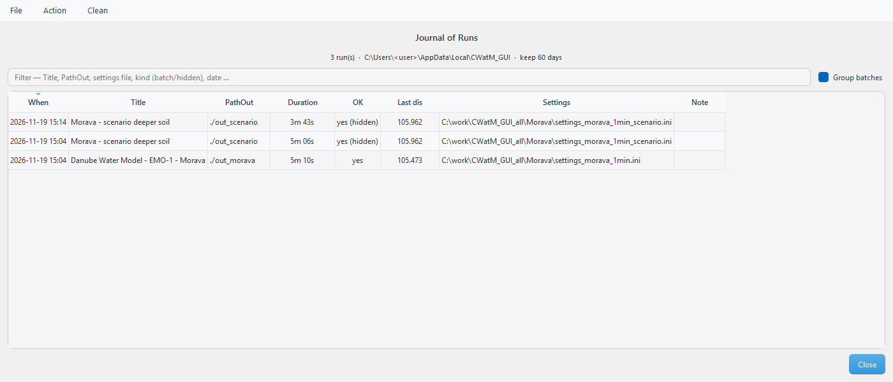

---

## 10. Show Basin

**Tools ▸ Show Basin** opens the basin viewer — a Leaflet (**EPSG:4326**) map with the
`ups.nc` upstream-area river network and the catchment **mask** overlaid on an OSM
basemap, drawn in native lon/lat (no reprojection blur). Projected x/y grids (e.g.
UTM33) are shown on the raw x/y without an OSM basemap.

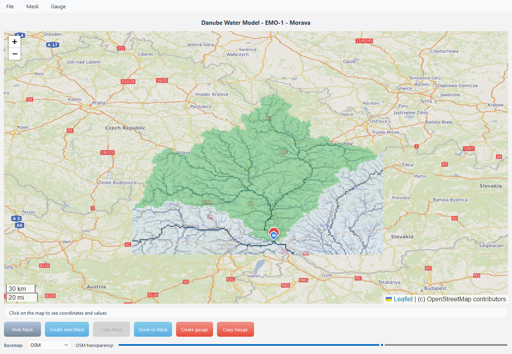

- **Markers**: red pins = the gauges (numbered `1..N`, taken from the Gauges box),
  a blue **M** = the mask-start, black = the last clicked cell. Hovering a gauge shows
  its **name** (from `GaugesNames` in the settings, matched to `Gauges` in order),
  coordinates and upstream area.
- **Click** anywhere to read the coordinates, basin area and mask state in the strip
  under the map.
- **Buttons** (also in the **Mask** and **Gauge** menus): Hide/Show Mask, Create new
  Mask, **Copy Mask**, Zoom to Mask, Create gauge / **Copy Gauge** (accumulate several
  gauges, then commit them all to the Gauges box). The **File** menu loads a **GeoJSON**
  or **Shapefile** overlay (e.g. a basin outline). **Clicking a gauge pin removes
  it** from the working list. **Copy Mask** also removes from Gauges every station
  that lies outside the new mask (typically left over from the previous basin); if none
  is left, the mask outlet becomes the gauge.
- **OSM transparency slider**: fades between only-the-data and the OSM basemap with the
  data on top; the start value comes from Preferences ▸ Display ▸ Initial map transparency. A **Basemap**
  dropdown switches the OSM style.

---

## 11. Check Data

**Tools ▸ Check Data** runs CWatM's own data checks against the settings (input maps,
resolutions, extents) and lists any trouble in a table. It works only with a
**file-based MaskMap** (not coordinates) — with a coordinate MaskMap the **Run Check**
button is disabled and says why. It can also compare against an existing discharge
NetCDF, and **Restore settings from discharge map** opens that file in
[Restore settingsfile](#137-restore-settingsfile--what-a-result-file-remembers).

The check **runs in the background**: the window (and the rest of the GUI) stays usable
while it reads every input file, with an elapsed-time counter, and **CWatM's output
appears in the log pane** below the table — including the traceback when something
fails. Because CWatM reads the settings **from disk**, unsaved changes are pointed out
before the check starts, with the option to save first.

The result table can be **sorted** by any column and narrowed with the **filter box**;
rows with a problem are tinted across their whole width, and the line above the table
counts them (*"312 rows · 7 not valid · 3 date mismatches"*). **Select trouble** keeps
only those rows, **Copy Table** and **Export CSV** take what is on screen, and a
**double-click on a row jumps to that key** in the settings editor. The result CSV is
written to `<PathOut>/check_cwatm1.csv` by default.

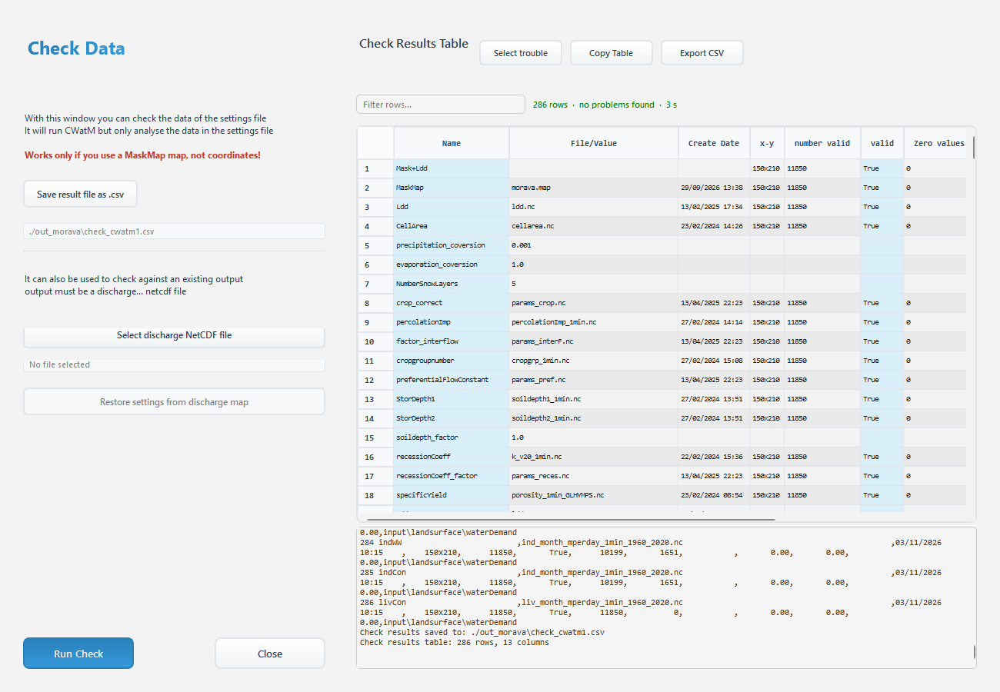

---

## 12. Excel Editor (Crops / Reservoirs)

**Tools ▸ Excel Crops/Reservoirs** — directly below *Change Options* — opens the workbook named in the
settings `Excel_settings_file` in an editable table that **reproduces the sheet's cell
colours** (fill and font).

- **Sheet tabs**: just like in Excel, a **tab bar below the table** (above the
  "N rows × M columns" line) lists **all** the workbook's sheets — *Crops*,
  *Reservoirs*, *Reservoirs_downstream*, *Reservoir_transfers*, … Click a tab to switch;
  a sheet holding unsaved edits is marked with a `*` on its tab.

  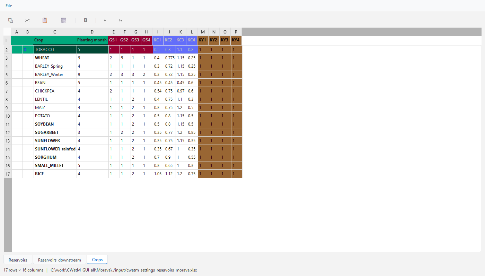

  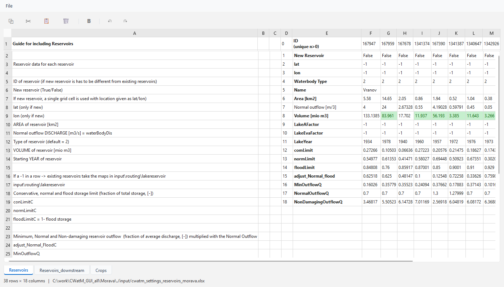

- Cells are **editable**; **Save / Save As** write the edits of **every** sheet you
  changed back through the workbook, **preserving all other sheets and styling**.
  **Reload** re-reads the workbook from disk and **Load** opens a different `.xlsx` in
  the same window (both ask first if there are unsaved edits). Very large sheets load
  instantly (the table is lazy — only the visible cells are read).

- **Closing with unsaved edits** asks **Save / Discard / Cancel** and names the sheets
  that still hold changes, so nothing is lost by closing the window.

- **Loading does not freeze the GUI**: the workbook is read in the background — the
  window shows *Loading …* and comes alive when the file is there. This is what you
  notice with a workbook on a network drive, where reading a megabyte can take half a
  minute.

### Working in it like in Excel

| What | How |
|------|-----|
| **Formulas** | Type `2+3.5`, `2 + I3`, `=(A1+B1)/2`, `=SUM(C2:C10)`. The cell shows the **result**; clicking into it shows the formula again, and it recalculates when a referenced cell changes. Functions: `SUM`, `AVERAGE`, `MIN`, `MAX`, `COUNT`, `ABS`, `ROUND`, `INT`, `SQRT`, `EXP`, `LN`, `LOG10`, `LOG`, `MOD`, `POWER`; ranges like `A1:B10` work inside them. A bad formula shows `#NAME?`, `#DIV/0!`, `#VALUE!`, `#SYNTAX` or `#CYCLE`. Prefix with `'` to keep the text as it is. |
| **Copy / paste** | Select one cell or a block, **Ctrl+C** (or **Ctrl+X**), put the cursor somewhere and **Ctrl+V**; **Delete** clears the selection. The same four are on the **right-click menu** over the cells. The clipboard format is tab-separated text, so you can paste into — and from — Excel, a text editor or the settings file. A paste that runs past the last row or column **extends the sheet**. |
| **Fill handle** | Select one or more cells and drag the **small square at the bottom-right corner** down, up, left or right. **A single cell fills its value into all the others.** From two or more cells a series is continued: numbers with a constant step (`1, 3` → `5, 7, …`), `Crop1, Crop2` → `Crop3, Crop4`, month/weekday/quarter names, and anything else repeats the block. |
| **Marking a whole line** | Click a column letter or a row number to mark the whole line — a full-line selection is shown in a **stronger gray** than an ordinary cell range. |
| **Whole columns and rows** | **Right-click a column header** for *Copy column*, *Insert empty column left / right*, *Paste N columns left / right* (it makes room for the block instead of overwriting) and *Delete column*. **Right-click a row number** for the same, with *above / below*. Marking several columns (or rows) first makes every action work on all of them. Deleting asks first when there is data in the line, and the question tells you whether **Ctrl+Z** can bring it back (only a very large deletion cannot be undone — then **Reload** is the way back). |
| **Where a copied column may go** | A full column or row can only be copied with **Copy column / Copy row in the header menu** (Ctrl+C over cells copies just those cells). Such a copy remembers what it is and where it came from, so a copied **row** is never offered as a column to paste, and a column can only be pasted back into **the sheet it was copied from** — the menu entry stays visible but greyed out, and its tooltip says why. A plain block of copied cells has no such restriction. |
| **Wide text columns** | No column is ever wider than about **120 characters**, and a column of text is shown at **half** that width and **wraps**, so the numeric columns stay visible. Drag the column border to make it wider or narrower — the text re-wraps and the rows re-height. |
| **Text that does not fit** | is **cut off at the column's edge** (with a `…`) — it is never drawn across the next column, where it would sit on top of that column's content. Widen the column to read the rest. Columns are sized to their content **and their header**, and a few known columns get a guaranteed minimum (the reservoir IDs in *Reservoir_transfers*, the description column of *Reservoirs*). |
| **Symbol bar** | Top left of the window: **⧉ copy · ✂ cut · 📋 paste · 🗑 delete │ B bold │ ↶ undo · ↷ redo**. Each button does exactly what its shortcut does, and is greyed out while it cannot be used (nothing selected, empty clipboard, nothing to undo). |
| **Bold** | Mark one or more cells and press **B** in the symbol bar (or **Ctrl+B**): the cells turn bold, and pressing it again on cells that are all bold takes the bold off. It is written into the workbook when you save, and **Ctrl+Z** undoes it like any other change. |
| **What is marked** | Marked cells are shown in **dark gray**; a whole marked column or row in an even darker shade, so the two are easy to tell apart. |
| **The header row** | The sheet's first row sits above the table and **never scrolls** — clicking it or spinning the mouse wheel over it scrolls the table underneath instead, so the header cannot get lost. It is **editable up there**: double-click a header cell (or press F2, or simply start typing) to rename a column; the change is undoable and is written when you save. Marking cells in the header row and pressing **B**, Delete, Ctrl+C/X/V or Ctrl+Z works on the header row, not on the table below — the buttons and shortcuts always act on the part you last worked in. |
| **Undo / redo** | **Ctrl+Z** undoes and **Ctrl+Y** (or Ctrl+Shift+Z) redoes — cell edits, pastes, fills, clears, **and** inserted or deleted whole columns and rows, up to 200 steps. Every sheet keeps its own history, and undo keeps working after a Save. |

> **Note** — a formula is saved as its **computed value**. CWatM reads these sheets with
> pandas/openpyxl, which cannot evaluate a stored formula, so writing the number is what
> keeps the workbook usable as model input. The formula stays live while the window is
> open.

---

## 13. Result Analysis

The **Analyse** menu visualises CWatM results. Each plot window can **Save HTML** — the
current plot as a self-contained page — and **Save PNG** — the plot as an image, at
the resolution set in **Preferences ▸ Editor & Dates ▸ PNG dpi** (default 150; 300
gives twice as many pixels in each direction). Save PNG is a button left of Save HTML,
or **File ▸ Save PNG** in Timeseries and NetCDF (a NetCDF map is saved as it is shown
on screen); Full Waterbalance has no PNG. Every file dialog opens in the output
folder (PathOut).

| Analyse ▸ … | Opens | Needs |
|-------------|-------|-------|
| Output Explorer | a browser of the output folder | – |
| Timeseries | a line chart of a result `.csv` | any CWatM `.csv` result |
| NetCDF | a map of a result `.nc`, animated over time | any CWatM `.nc` result |
| Watercycle ▸ Watercycle / Flow Diagram / Chord Analysis | the water balance as sunburst / Sankey / chord diagram | WaterCycle csv |
| Watercycle ▸ Mean Weekly Fluxes / Annual bars | the seasonal cycle / one column per year | **daily** WaterCycle or WaterBalance csv |
| Full Waterbalance | the balance of every part of the water cycle | WaterBalance csv |

The **WaterCycle csv** comes from `OUT_TSS_AreaSum_Daily = WaterCycle`, which **Tools ▸
Add output Watercycle** writes into your settings; the **WaterBalance csv** from **Tools ▸
Add output WaterBalance**. Wherever a window shows a station's lon/lat, the **nearest
city** and its distance follow it (e.g. *lon: 16.61, lat: 48.91 - 26 km from Břeclav
(CZ)*) — offline, from GeoNames' list of places with more than 15,000 people.

### 13.1 Output Explorer

**Analyse ▸ Output Explorer** is a browser of the resolved **PathOut** folder:
**double-click** a result and it opens in the matching viewer — `.nc` → NetCDF map,
`WaterCycle*.csv` → sunburst, other `.csv` → Timeseries. It turns "run → analyse" into
one click instead of a file dialog.

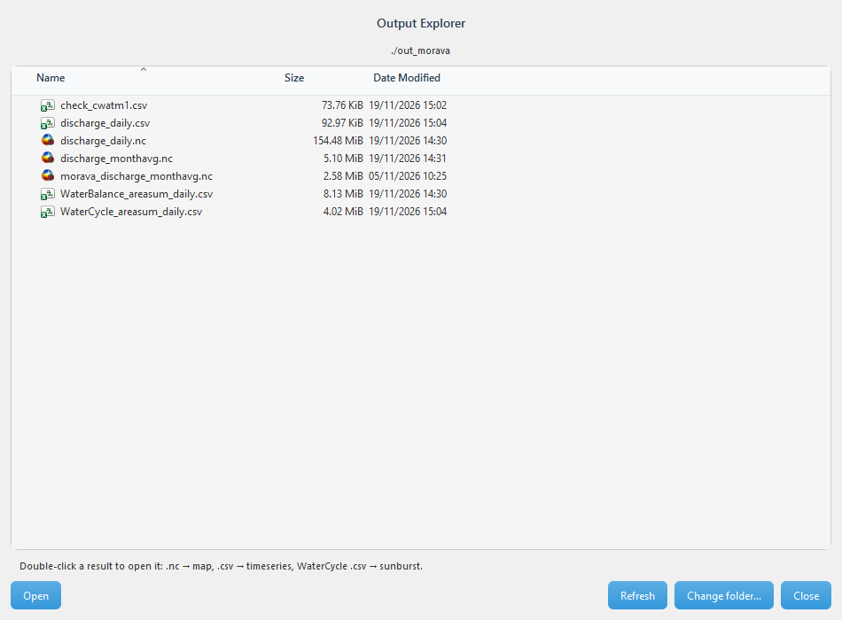

### 13.2 Timeseries

**Analyse ▸ Timeseries** plots a result `.csv` (e.g. `discharge_daily.csv`) as a line
chart. Multiple columns are shown one at a time (Forward/Backward); **Action ▸ Compare**
overlays another result file; **File ▸ Save as csv** exports the shown series in the
CWatM result-CSV format. **Action ▸ Flow duration / Flow regime** open the column on
screen in its own window ([§13.4](#134-flow-duration-and-flow-regime)).

- A **range slider** below the plot shrinks the displayed period from either end.
- **Load observed** overlays an observed series (a CWatM `.csv` or a simple
  `date,value.csv`) and shows goodness-of-fit metrics — **KGE / NSE / PBIAS / RMSE** —
  computed over the period the slider selects. This is the model-evaluation step you no
  longer need Excel/Python for.

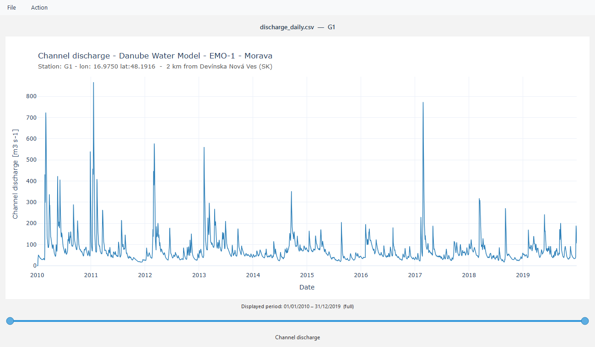

### 13.3 NetCDF

**Analyse ▸ NetCDF** shows a result `.nc` (e.g. `discharge_daily.nc`) as a raster
overlay on an OSM map (EPSG:4326). A **timestep slider + Play** scrubs through time; a
**colour-scale** selector (menu **Display**), **Log scale** toggle and the **OSM
transparency** slider (directly below Play) tune the display. Click a cell to read its value. The gauges appear as small
numbered red pins: the ones stored in the file itself (global attribute `Gauges`,
written by the run with each gauge's name and upstream area), or - for an older file
without it - the Gauges of the settings file. Hovering a pin shows the gauge's
**name** and its **upstream area**. Clicking a shape loaded with **File ▸ Load JSON / Load shape** shows
its attributes; for a **point** the popup also offers **Make this point a gauge** and
**Make all points to gauges** (every point of that file). They become selected points
just like clicked cells: numbered pins that the Timeseries, Flow duration and Flow
regime actions use, and a left click on a pin removes it again.

- **Left-click** a cell (or a gauge pin) to select it as a numbered point; click more
  cells to add stations, and click a selected cell or its pin again to remove it.
- Plot the selected cells' series with **Fast Display Timeserie** (quick — the map's
  timesteps only, with gaps) or **Total Timeseries** (every timestep — can take a while,
  so a progress bar with a **Cancel** button shows while it reads). **Right-click the
  map** for the same Action menu; **Remove gauges** clears every selected point.
- **Compare A−B** loads a second `.nc` on the same grid and shows the **difference**
  (this − other) per timestep on a red/blue diverging scale — ideal for comparing two
  scenarios you just ran. **Log scale** on a difference map is symmetric around zero:
  no change stays white, the sign decides red or blue, and small differences become
  visible next to the large ones. **Clear compare** returns to the single-file view.
- **File ▸ Load netcdf** opens another `.nc` - starting in the current file's folder - in
  the same window.
- **Calculate mean** / **Calculate percentile** (Action menu) turn the whole time axis
  into one map - the mean, or a percentile you enter (e.g. 50 for the median) - saved as
  a new NetCDF in the original's folder (suggested `discharge_mean.nc` /
  `discharge_50_percentile.nc`). It keeps all metadata of the original and records its
  name, folder and creation time; the map then shows the new file.
- **Save as a .tif** writes the map of the shown timestep as a GeoTIFF
  (`<name>_<ddmmyyyy>.tif`).
- **File ▸ Load JSON / Load Shapefile** draw an outline (e.g. a basin border) on the map.
- A grid in projected x/y coordinates (e.g. UTM) is shown on its own x/y, without the
  OSM map.

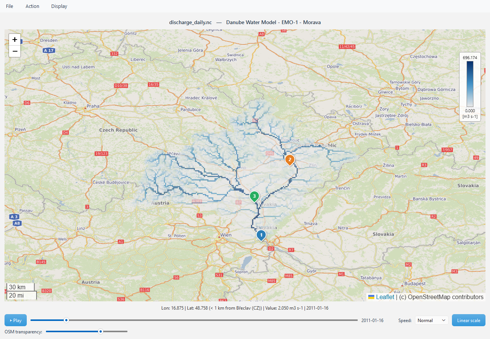

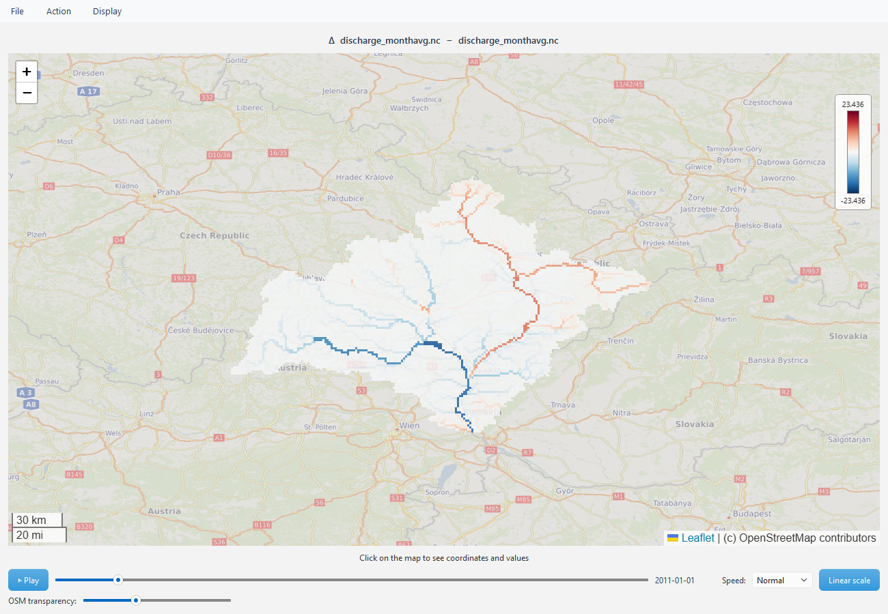

### 13.4 Flow duration and Flow regime

Both plot **one series** — the column on screen in Timeseries, or the **last point you
clicked** on the NetCDF map. **Flow duration** ranks each year's values into an
exceedance-probability curve; **Flow regime** shows the seasonal cycle (day-of-year or
month-of-year). Every year is a thin line plus a black cross-year **average**, with
buttons to hide the single years, show light-gray 0–100 % / 40–60 % **percentile
bands**, save the per-year table as csv, or save the plot as HTML. Opened from
Timeseries, the window follows the range slider's period.

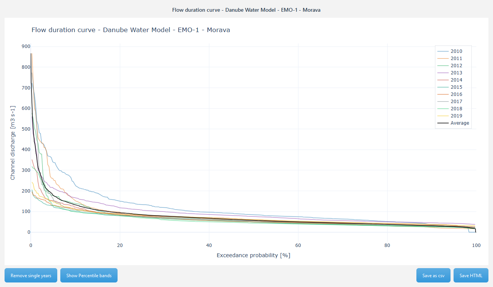

### 13.5 The Watercycle views

**Analyse ▸ Watercycle ▸ …** holds five views of the same water balance of the basin.
They share **Backward / Forward** buttons when the csv holds several stations (title =
the settings `Title`, subtitle = the station's lon/lat and nearest city), a **month range
slider** that sets the analysed period, **Save HTML** and **Save CSV** (the numbers
behind the plot). When the run did not limit abstraction (`limitAbstraction = False`),
the demand the model could not meet counts as an input *Fossil groundwater* (Sankey:
*Other source*) and what of it is lost as an output *Unmet demand lost*.

#### Watercycle

The overall water balance as a **sunburst** (Inputs / Outputs / Storage /
Evapotranspiration / Transpiration) in mm/year, river discharge in m³/s. **Save CSV**
saves every part's volume (km³), mm/year and percent for the shown station and period
(suggested `watercycle.csv`).

**Right-click a sector ▸ Timeseries** plots that sector month by month over the whole
file — fluxes in mm/month, storage in mm, discharge in m³/s. **Add to timeseries**
draws another sector into the last opened one (discharge is converted to mm/month once
it is not alone).

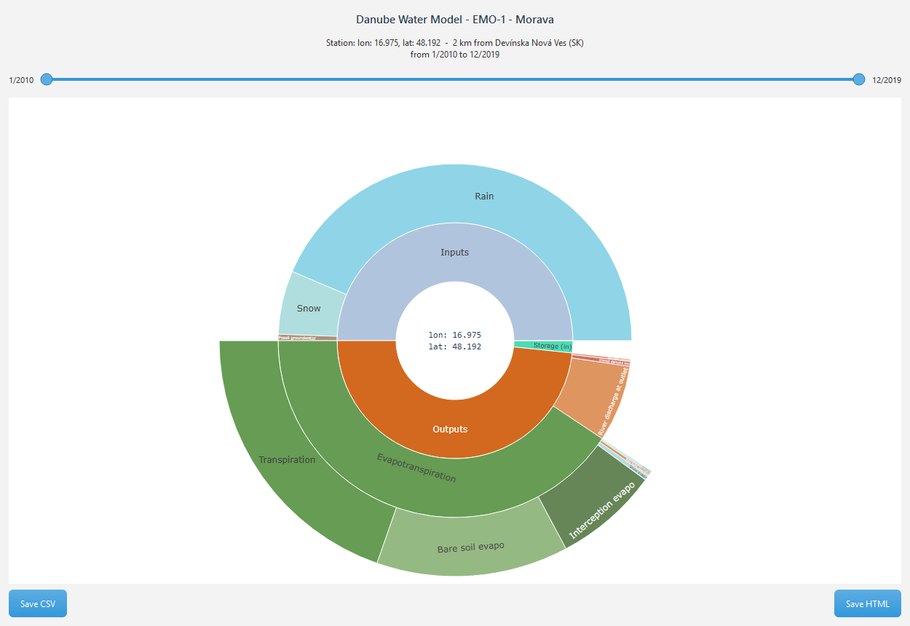

#### Flow Diagram

The same water balance as a **Sankey** flow diagram (Precipitation → Rain/Snow →
Soil/Groundwater/Runoff → Waterbodies → Discharge, plus withdrawal, consumption,
glacier and channel evaporation). Click a node to highlight its branch; **right-click a
node or flow ▸ Timeseries / Add to timeseries** works as in Watercycle. **Save CSV**
saves one row per flow (from, to, mm/year) as `flowdiagram.csv`.

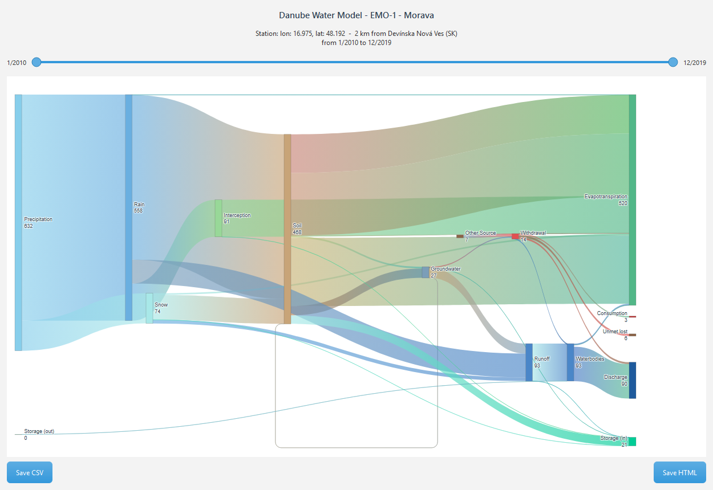

#### Chord Analysis *(experimental)*

The flows of the Flow Diagram as a **chord diagram**: every part of the water cycle is an
arc, every flow a ribbon whose width is the amount. **Click an arc**: the 1st click keeps
only its flows, the 2nd only the inflows, the 3rd only the outflows, the 4th (or a click
on the background) shows everything again.

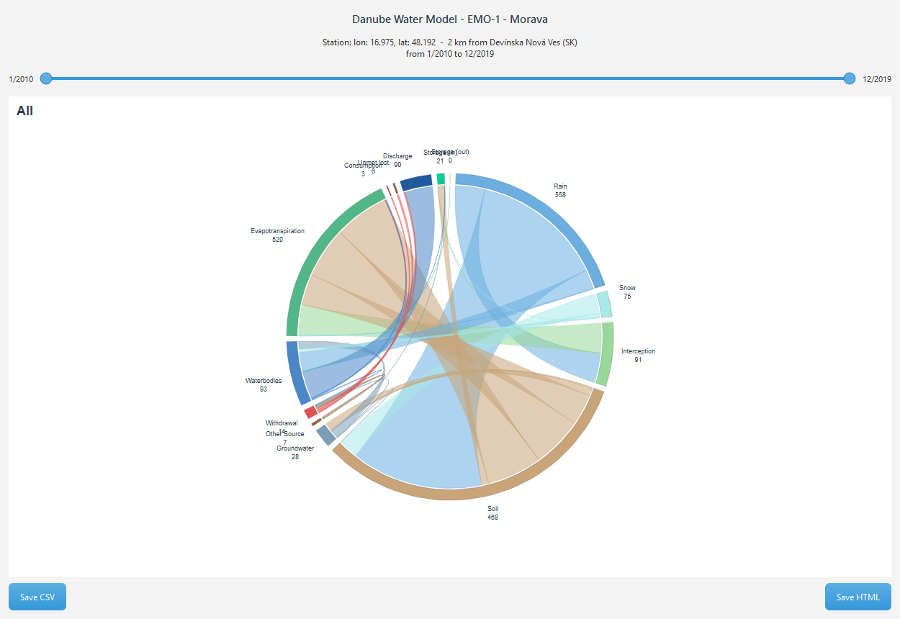

#### Mean Weekly Fluxes *(experimental)*

The **mean seasonal cycle** of a **daily** WaterCycle or WaterBalance csv: for every week
of the year the mean over all years of the slider period, one filled panel per component
on a shared January–December axis (fluxes in mm/week, storages in mm). The **⚙ gear**
picks the panels from ~50 components; the choice is remembered.

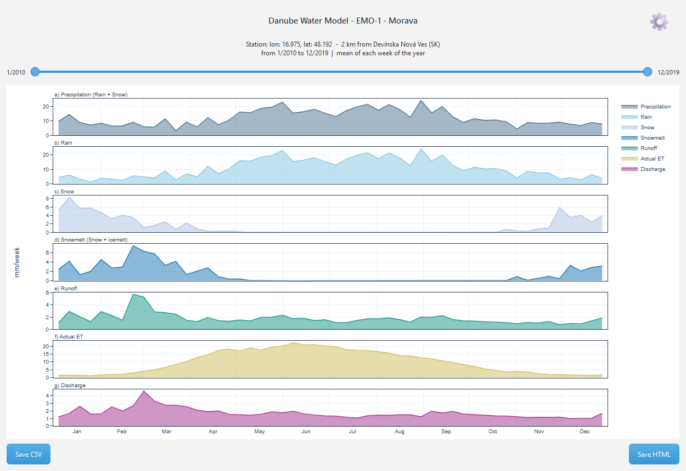

#### Annual bars

The components of a **daily** WaterCycle or WaterBalance csv summed per **complete
year**: one **stacked column per year** in mm/year (a storage as its annual mean in mm).
Same colours and **⚙ gear** as Mean Weekly Fluxes, with its own remembered choice
(default: Surface Runoff, Interflow, Baseflow — how the runoff splits, year by year).

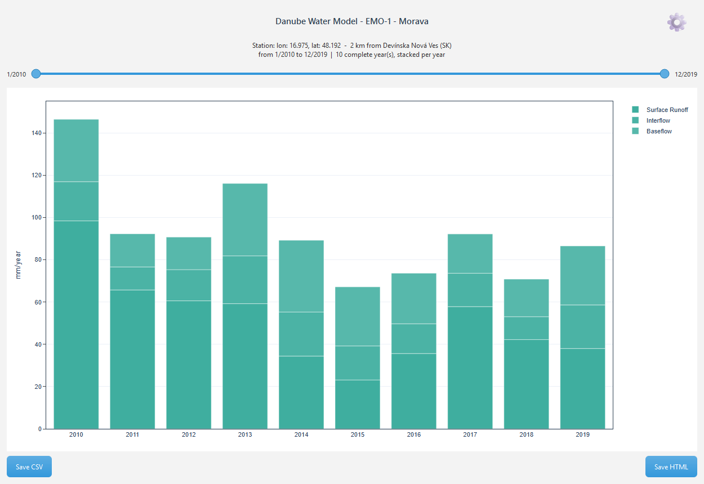

### 13.6 Full Waterbalance

**Analyse ▸ Full Waterbalance** checks the balance of **every part** of the water
cycle, not just the overall one. It reads `WaterBalance_areasum_daily.csv` (add the
output with **Tools ▸ Add output WaterBalance** and run CWatM) and shows in one
scrolling page:

- a **table** of all water-cycle parts — In, Out, storage change and balance error in
  mm/year; an error above 1e-3 of the inputs is **red** — plus the parts that are not a
  balance or are not drawn;
- the **sunbursts** of the parts: total, interception and soil, the three soil layers,
  soil per land cover, groundwater and runoff concentration, the MODFLOW layers,
  evapotranspiration, potential vs. actual ET, storage change, snow and glacier,
  lakes / channels / routing, water demand and use — only for the options that are on.

A **month slider** fixed above the page sets the period, **Backward / Forward** switch
the station, **Save HTML** keeps the whole page and **Save CSV** the table. A long run's
WaterBalance csv is large, so reading it may take a moment.

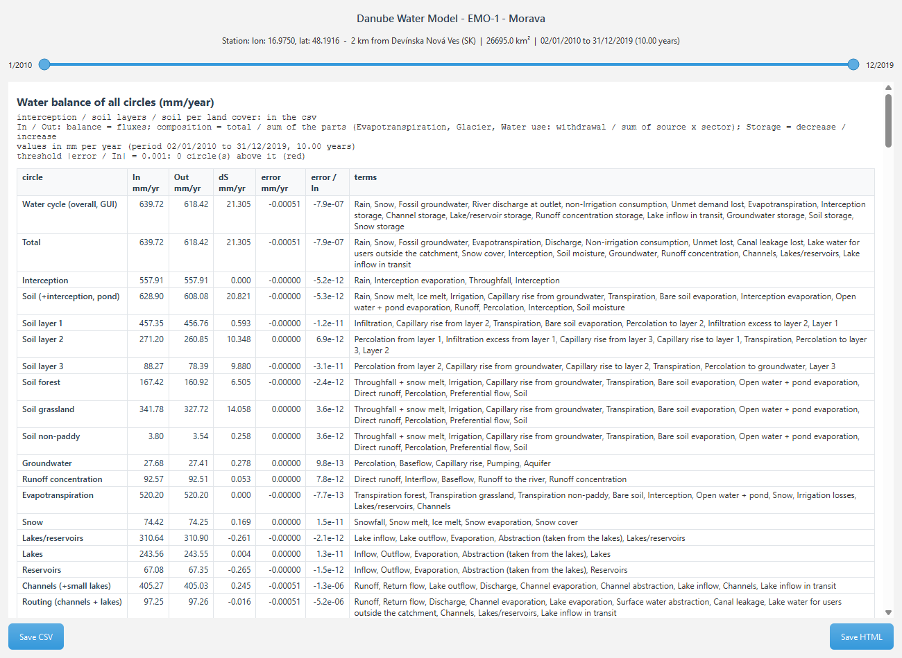

### 13.7 Restore settingsfile — what a result file remembers

Every CWatM discharge/ET output file carries the **complete settings file** and the
**list of input files** the run used. **Tools ▸ Restore settingsfile** opens such a
`dis*.nc` and shows what is inside — a **summary card** (Title, when it was created,
which CWatM version, which settings file) above the full attribute table:

- **Preview settingsfile** — read the stored settings in a read-only editor, with the
  usual colouring and folding, *before* deciding anything. From there: **Save as…**,
  **Load into editor (unsaved)** — the settings go into the main editor without writing
  any file, and one **Ctrl+Z** takes it back — or **Compare with current**.
- **Compare with current** — a side-by-side diff of the stored settings against the ones
  you have loaded: what did this run do differently?
- **Restore settingsfile** — write the stored settings to a new file and load it. The
  suggested name is `<title>_<run date>.ini`, and unsaved edits in your current file are
  pointed out first.
- **Show Inputfiles** — the recorded input files with the date the run saw, plus a
  **check**: is each file still there (**missing**, red), is it still the same version
  (**changed since the run**, orange), or is everything as it was? A line above counts
  them, **Re-check files** repeats it, and a **double-click opens the file** — a NetCDF
  in the map viewer, anything else in your desktop's program for it.
- The commands sit in the **File** (Export as CSV), **Action** (Preview, Compare, Show
  Inputfiles) and **Restore** menus. **Ctrl+C**, a right-click menu and **Export as
  CSV** work on both tables. Items a file cannot serve (an output without stored
  settings) are greyed out with the reason.

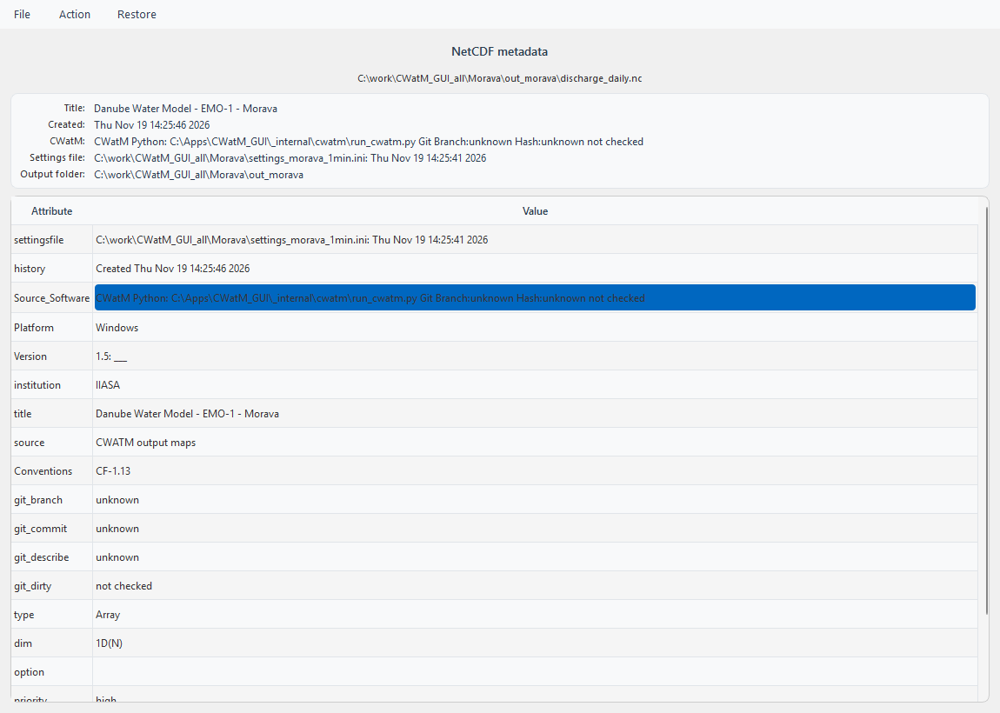

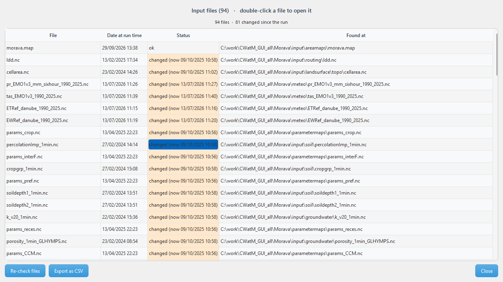

---

## 14. CWatM AI (NotebookLM)

The **CWatM AI** button (left of *Help*) opens a chat window where questions about
CWatM are answered by Google **NotebookLM** (Gemini). NotebookLM is a *grounded* AI: it
answers only from the **sources in a notebook** — for CWatM that is the CWatM
documentation — which makes answers verifiable and greatly reduces made-up replies.

CWatM AI needs a **one-time Google sign-in** ([§14.2](#142-sign-in-from-cwatm)). By
default it asks the **openly available CWatM notebook** maintained for the GUI, so no
preparation is needed. To use a notebook of your own instead, paste its link or id into
**Preferences ▸ Editor & Dates ▸ NotebookLM** (or the **Notebook…** button of the chat
window); emptying the field goes back to the default.

### 14.1 Your own NotebookLM notebook *(optional)*

Only if you want answers from your own sources — do this once in your browser at
**notebooklm.google.com**:

1. **Sign in** to NotebookLM with a personal Google account (or a Workspace/school
   account — those may need administrator approval). If it is your first visit, complete
   any **age verification** Google asks for (Google Account → *"Access age-restricted
   content and features"*). *If NotebookLM works in the browser, CWatM AI can use it.*
2. **Create a new notebook** and give it a clear title (e.g. `CWatM`).
3. **Add the CWatM sources.** Upload the CWatM documentation PDFs as sources. The GUI
   ships one ready to use — **`documentation/CWATM_shorter.pdf`** — and you can add
   more for deeper coverage:
   - `CWATM_shorter.pdf` (the condensed CWatM documentation — a good default),
   - the CWatM model-description papers (e.g. the *GMD* CWatM papers), the supplement,
     and any of your own CWatM notes/protocols.
   The more focused and CWatM-specific the sources, the better the answers.
4. Wait until NotebookLM shows every source as **ready** (green), then ask it a test
   question in the browser to confirm the notebook works.
5. Copy the notebook's **URL** from the browser and paste it into **Preferences ▸ Editor
   & Dates ▸ NotebookLM**. An open CWatM AI window uses it from the next question on.

### 14.2 Sign in from CWatM

Open **CWatM AI**, click **Login** and choose a browser — **Microsoft Edge**, or **Google
Chrome** (the installed one; your last choice is remembered). A separate
window of that browser opens on **Google's own sign-in page**; sign in there and it
closes by itself. Your password goes only to Google, none of your browsers' cookies or
data are read, and no administrator rights are needed. If the chosen browser is not
installed, CWatM says so and lets you choose another.

- The login-state line at the top of the window shows **Logout** (blue) once a
  working session is confirmed, **Checking…** while it verifies, or **Login**
  (red) when you need to sign in.
- After a successful login the session is **stored and reused automatically** on later
  runs — you normally sign in only once, until Google expires it.
- **What the login stores.** Before the first login CWatM AI asks once, and explains it:
  it **stores the Google session in a file on this computer** —
  `%USERPROFILE%\.notebooklm\profiles\…\storage_state.json`. Anyone, or any program,
  with access to your Windows account could use that file to act as your Google
  account, so treat it like a password. **Delete the file (or the `.notebooklm`
  folder) to remove the session.** It is used only to ask NotebookLM and is never sent
  to the CWatM account server.

### 14.3 Using the chat

- **Ask a question:** type in the input box and press **Enter** (**Shift+Enter** for a
  new line) or click **Send**. Answers stream back and are rendered as **Markdown**
  (bold, lists, tables, code). While a question is in flight, **Send** becomes **Stop
  thinking** to cancel it.
- **Answer length:** the **Short / Long** toggle sets how detailed replies are
  (Short is fastest). Your choice is remembered.
- **Question history:** press **Up / Down** in the input box to recall previous
  questions. The transcript and history are **kept across close/open**.
- **Explain current line:** the **Explain current line** button (or typing "explain
  this line") asks NotebookLM to explain the settings line your editor cursor is on.
- **Notebook… / Clear / Exit:** point at a specific notebook, clear the transcript, or
  close the window (your session and history are saved either way).

### 14.4 Getting good answers

- **Be specific.** Instead of *"explain routing"*, ask *"What does the `PathOut` option
  control and what files are written there?"* — precise keywords retrieve the right
  passage.
- **Verify with the sources.** Answers point back to the notebook sources; read a little
  around a cited snippet to be sure a detail wasn't taken out of context.
- **It stays inside its sources.** A refused / "not found" answer usually means the
  question is **outside the CWatM sources** — add a relevant source to the notebook or
  rephrase with exact CWatM keywords.

> CWatM AI is an **experimental** aid. Its grounding makes it far more accurate than a
> generic chatbot, but verify against the CWatM documentation and code before relying on
> it for a decision. For the full NotebookLM feature set, use **notebooklm.google.com**
> directly — the CWatM AI window is a focused chat client over your CWatM notebook.

A dedicated guide is also in **`documentation/CWatM_AI_NotebookLM.md`** (Help ▸ FAQ links
to it).

---

## 15. Configuration and Appearance

All GUI settings live in one **Preferences** window, opened with
**Configure ▸ Preferences…**, **Ctrl+,**, or the **⋮** button on the far right of the
menu bar. Pick a category in the list on the left — *Output · Startup & Model ·
Display · Editor & Dates · Run History · Account · CWatM Academy* — and set it on the
page that appears.

Your edits are **buffered**: **Apply** puts them into effect and leaves the window
open, **OK** applies them and closes, and **Cancel** discards anything not yet
applied. All settings are persisted across sessions (except *Write output box*, which
always starts off).

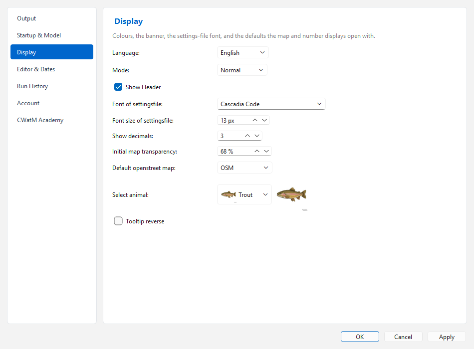

**Output**

- **Output box file** — the file the output box is appended to, with a **Browse…**
  button. Leave it empty to use the default `<PathOut>/cwatm_out.txt` (shown greyed in
  the field).
- **Write output box** — actually write the run log to that file. This one is *not*
  remembered: it always starts off, because logging can slow a run down on a network
  share.

**Startup & Model**

- **Load previous settings at start** — re-open **all** the tabs of the last session
  automatically at the next startup (the file you were working in on top). A settings
  file passed on the command line wins and opens on its own.

*(MODFLOW needs no setting: a run with `modflow_coupling = True` loads `flopy` and
`xmipy` by itself. It also needs the MODFLOW 6 library `libmf6`, whose path you set in
the settings — the GUI does not ship the DLL.)*

**Display**

- **Language** — the language of menus, menu items, buttons, labels and tooltips:
  **English** (default), Deutsch, Français, Español, Italiano, Magyar, Română, Srpski,
  Hrvatski, Slovenčina, Български, Čeština, Українська. Switches live and is remembered;
  messages, window titles and the settings file itself stay in English.
- **Mode** — colour theme of the whole GUI: **Normal** (light), **Dark**, **Mikhail**
  (black + amber). Switches live and is remembered.

  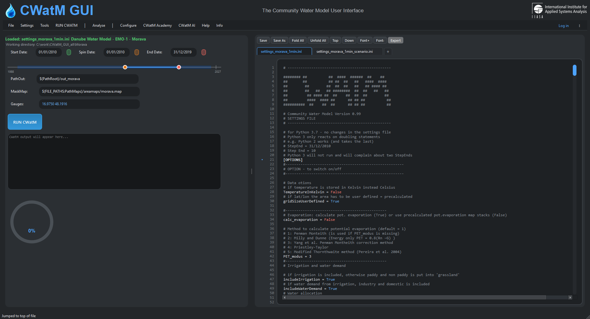
- **Show Header** — show or hide the top banner (CWatM icon + title + IIASA logo).
  Turning it off moves the menu, panels and editor up to reclaim the space.
- **Font of settingsfile** / **Font size of settingsfile** — the (monospaced) family and
  the size the settings editor renders with; the size is the same setting as the
  **Font+ / Font-** buttons next to the editor.
- **Show decimals** — how many decimals every numeric read-out shows (default 3).
- **Initial map transparency** — the transparency (0–100 %) that Show Basin and NetCDF
  open with.
- **Default openstreet map** — the default basemap for the map windows.
- **Select animal** — the little animal on the live discharge sparkline during a run,
  with a preview. The **Trout** and the **Bottle** are free for everyone; Catfish,
  Clownfish, Salmon, Otter, Beaver and Octopus are bought in the **Shop**
  ([§17](#17-cwatm-account-badges-and-the-shop)), and the **Mole** is the reward for
  the first run coupled with MODFLOW. Only the animals you own are listed.
- **Tooltip reverse** — show tooltips light-on-dark instead of the usual dark-on-light,
  in every window at once.

**Editor & Dates**

- **Skill of user** — **Beginner / Advanced / Expert**: how much of the settings file is
  shown. Same setting as the coloured level button next to the editor. **Every level is
  free**, logged in or not.
  - **Beginner** shows `[FILE_PATHS]`, `[MASK_OUTLET]`, `[TIME-RELATED_CONSTANTS]` and
    `[OUTPUT]`; **Advanced** adds `[OPTIONS]`, `[INITITIAL CONDITIONS]`, `[METEO]` and
    `[EVAPORATION]`; **Expert** shows everything. Hidden sections are still saved and
    searched — just not displayed.

    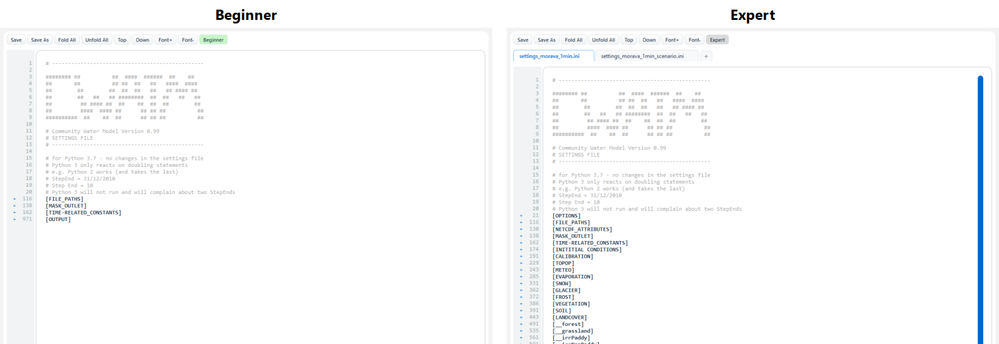
  - **Beginner also simplifies the menus** — the entries marked *Adv.* in
    [§5](#5-menus-and-keyboard-shortcuts) are hidden (e.g. Change Options, the Excel
    editor, Check Data, Journal of Runs, Windowed and Batch Run, Flow Diagram, Full
    Waterbalance). *Analyse ▸ Watercycle ▸ Watercycle* stays, because the CWatM Academy
    uses it.
  - **Expert only**: the settings-file **tabs**, *Settings ▸ Compare Tab* (F8) and
    *RUN CWATM ▸ Create batch*.
- **Web-style date picker** — the Start/Spin/End fields use a 📅 button + calendar
  popup (on) or the classic drop-down calendar (off).
- **Date timeline** — show the three-handle Start/Spin/End timeline below the date
  fields; drag a handle (or click the track) to set a date. The light band behind it is
  the meteo-forcing coverage.
- **Bookmark Change** — auto-bookmark a line when it is edited.
- **Use Tabs** — show the tab bar above the editor, so several settings files can be open
  at once (**Expert** level only; see [§6](#6-editing-settings)). Unticking hides only the
  bar — the open tabs keep their content and the active file stays in the editor.
- **PNG dpi** — the resolution of **Save PNG** in the Analyse windows (default 150).
- **NotebookLM** — the notebook CWatM AI asks: the openly available CWatM notebook
  (default) or the link of your own ([§14](#14-cwatm-ai-notebooklm)).

**Run History**

- **Run history folder** — where the **Journal of Runs** is stored, with a **Browse…** button
  (default `%LOCALAPPDATA%\CWatM_GUI`).
- **Run history retention** — how many days of runs to keep; **0** shows as
  *keep forever*.

**Account**

- **Stay logged in on this computer** — keep the CWatM account login (stored in the
  Windows credential store) and restore it in the background at start. Unticking drops
  the stored login at once.
- **Count my full CWatM runs (earn points)** — report every successful run (main,
  Windowed, Batch) to your account.
- **Reset MODFLOW reward (the mole)** — a button: the next successful coupled-MODFLOW
  run earns the mole again, with its popup. No points change.

**CWatM Academy**

- **Enable CWatM Academy** — open the Academy now and at every start until you untick it.
- **Link CWatM Academy to your login** — while logged in, your Academy progress is kept
  in your account (continues on any computer) and every finished level earns points.
  Logged out, progress is kept on this computer; the two are never merged.

---

## 16. CWatM Academy

**CWatM Academy** (the button in the menu bar, left of *CWatM AI*) is a guided
introduction to CWatM in **ten levels**. Each level explains one step, then points at
the real menu items and buttons in the GUI with speech-bubble guides, so you learn by
doing it on an actual model:

| Level | Topic |
|-------|-------|
| 1 | Welcome to CWatM — load a settings file and find a basin's outlet on the map |
| 2 | Running CWatM and visualising the water cycle |
| 3 | Running CWatM |
| 4 | Checking before you run |
| 5 | Choosing what CWatM writes |
| 6 | Looking at results |
| 7 | Turning physics on and off |
| 8 | Forcing and initial conditions |
| 9 | Many runs at once |
| 10 | Going Expert |


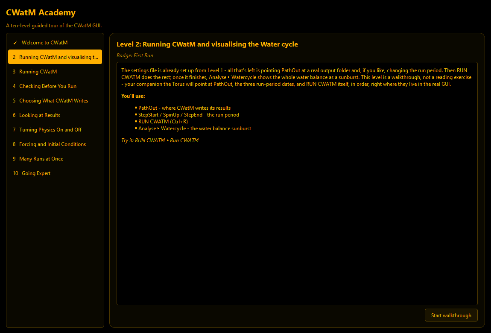

- **Free and without a login** — every level. Opening the Academy switches the skill
  level to **Beginner** (switch back whenever you like).
- **Progress** is kept: logged in (and *Link CWatM Academy to your login* ticked) in
  your account, otherwise on this computer. A finished level shows **Completed ✓ - do it
  again**; **Start Over** clears the progress.
- **Points**: logged in, each level you finish earns **5 points** — once per level.

### The Field Test (Level 1)

Level 1 ends with a small map game: a random one of the world's **100 largest river
basins** is named, and you click its **outlet** on the map.

- **+1000** points for finding a basin; every wrong click costs its distance in **km**
  (at most 1000, then 500, then 250 per basin); **Another basin** costs 500 while the
  shown one is not found yet. A found basin is drawn on the map.
- From **5000** points the whole world map is shown instead of a zoomed-in frame.
- From **10000** points you reach **Level 2**: only the basin's **shape** is shown,
  without its name — click anywhere inside it. From 15000 points on the whole world map,
  from 20000 points all 100 basins.
- Top right: your **Points**, the **Highscore** of all users (with the holder's
  initials) and **Your best**. Beat the record while logged in and you can enter your
  initials.
- **End test** shows your statistics and closes; one basin found passes Level 1. The
  **Field Test badge** (bronze / silver / gold) is shown in your account's *Addition*
  window.

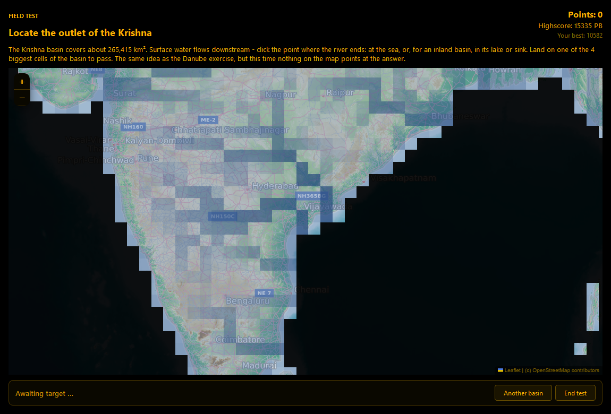

---

## 17. CWatM Account, Badges and the Shop

The CWatM account is **optional** — CWatM, the GUI, every skill level and the Academy
work fully without it. Click **Log in** in the menu bar's right corner to log in or
**register** (an e-mailed code confirms the address; *Forgot password* works the same
way).

- **Points**: logged in, every successful full CWatM run with a **new model setup**
  earns **1 point** (the same setup counts once; a daily cap applies), and every
  finished Academy level earns 5. A run that does not count says why in the output box.
  Runs made while logged out are sent at your next login.
- **River badges** (Breg, Thames, Morava, Danube, …) come with the points you earn.
  The account window shows your badges and the progress to the next one.
- **Additional badges** (*Addition* button in the account window): the **feature
  badges** **MoleFlow** (coupled MODFLOW), **pySnowClim** and **Glacier OGGM** — bronze
  with the first successful run with that option on, silver at 20 runs, gold at 50 —
  and the **Field Test badge** with your Field Test best and the record of all users.
- **What is sent**: no paths and no settings content — only a fingerprint of the
  settings (to recognise a new setup) and the number of timesteps. Run locations,
  appearing on the leaderboard and showing your location on the world map are each
  **optional and off** unless you tick them. Details: **Help ▸ CWatM account privacy**.
- The account window also offers **Export my data** and **Delete account**.

### Leaderboard and World Map

- **Info ▸ Leaderboard** (while logged in) ranks the users who opted in by their current
  points, with country and highest badge; your own row is highlighted.
- **Info ▸ World Map** (for everyone) shows **CWatM runs** — anonymous counts of where
  CWatM was run — or **User locations** — only users who ticked *Show my location on the
  world map*, no names, rounded to 0.5°. A circle's area grows with its count.

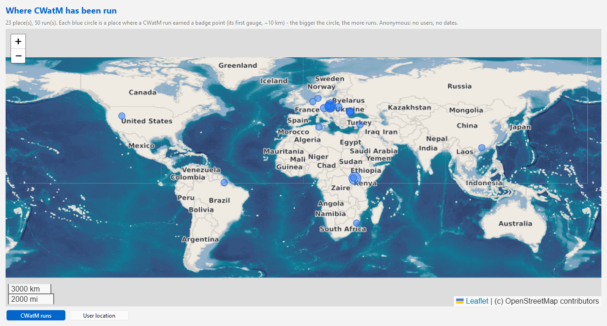

### The Shop

Once you hold the **Breg** badge, a **Shop** button appears in the menu bar, left of
your name. It sells **animals** for the live discharge sparkline (Catfish, Clownfish,
Salmon, Otter, Beaver, Octopus); the **Trout** and the **Bottle** are free for everyone,
and the **Mole** is the reward for your first coupled-MODFLOW run, never sold.

- **Two numbers.** *Your points* are what you can spend (shown on the account button
  and the leaderboard). *Earned in total* never goes down and decides your badges.
- **Buying** asks for confirmation, takes the price from your points and is final.
  Your badges stay, and the next badge still needs its full earned points. A bought
  animal appears on the discharge plot at once.
- If you cannot afford anything yet, the Shop says how many points the cheapest animal
  still needs.
- **Points shrink when you do not use CWatM GUI.** If you do not log in for a week,
  your points drop by 3 %; every further week by another 5 % of what is left — never
  below 5 points. Logging in (also the automatic login at start) stops it; you are told
  in the output box when points were lost. Earned points and badges never shrink.
- What you bought is stored in your account and works on any computer; a copy kept on
  your computer covers a missing connection.

---

## 18. Building the Executable and Installer

A release is built with the script **`build_release.ps1`**, which copies the source to a
local build folder (never build on a network drive), runs PyInstaller with
`cwatm_gui_dir.spec`, compiles the installer and copies the results back:

```powershell
pwsh -NoProfile -Command "& '.\build_release.ps1'"                    # full release
pwsh -NoProfile -Command "& '.\build_release.ps1' -Steps sync,build"  # exe only
```

The result is `dist/CWatM_GUI/CWatM_GUI.exe` (plus an `_internal/` folder that also
contains the lightweight `CWatM_model.exe` child process used for model runs). The
spec collects rasterio + GDAL data, xarray backends, folium/plotly, **openpyxl**,
requests, QtWebEngine, the **MODFLOW** stack (flopy + matplotlib + xmipy), the CWatM AI
libraries (`notebooklm` + `playwright`), the `cwatm`/`src` code and the documentation.

The **per-user installer** (no administrator rights) is compiled from the Inno Setup
script `installer/CWatM_GUI.iss` (the script's `installer` step). It copies `dist\CWatM_GUI\` verbatim (keeping `_internal\` intact), offers a
desktop shortcut and an optional `.ini` "Open with" association, and installs into the
current user's locations. Packaging details are in `documentation/CWatM_GUI_Build.md`.

---

## 19. Troubleshooting

- **A map or plot is blank** — the map/plot windows need QtWebEngine; behind a
  corporate proxy the tiles are fetched with Python (proxy-proof). If the OSM basemap
  is missing, only the tiles failed — the data overlay and controls still work.
- **"Gauge is not inside the basin!"** — move the gauge (Tools ▸ Set max Gauge or the
  basin viewer's Create/Copy Gauge), or fix the MaskMap.
- **"PathOut does not exist!"** — Tools ▸ Create PathOut Folder.
- **Check settingsfile flags a line** — red = the resolved file/folder was not found
  (the output box lists the resolved path; `Path…` keys are checked as directories);
  **light orange** = the file exists under another extension, or is not read with the
  current options (a soft note, not an error); a **strong-red** line means a *duplicate
  key*, not a missing file.
- **The run stops early with a date/time error** — the run window is likely past your
  forcing data; run **Check settingsfile** (F4), which warns when `StepEnd` is after the
  meteo forcing ends.
- **CWatM AI says "Login"** — the Google session expired, or none was found.
  Click **Login**, choose Edge or Chrome and sign in. With your own notebook, check its
  link in Preferences ▸ Editor & Dates ▸ NotebookLM — see [§14.1](#141-your-own-notebooklm-notebook-optional).
- **A MODFLOW run fails** — it needs `xmipy` + `flopy` installed and the `libmf6`
  library path set in the settings.
- **A run fails and the message is not clear** — run it again with **RUN CWATM ▸ Run
  CWatM + error message**, which names the code line where it failed.
- **A menu entry described here is missing** — it is hidden at your skill level; switch
  to Advanced or Expert with the level button next to the editor.
- **Linux: the window or a map does not appear** — run `./gui.sh --check`; see
  `cwatm_gui_linux.md`.
- **Diagnostic log** — swallowed errors are written to
  `%LOCALAPPDATA%/CWatM_GUI/gui.log`.

**More answers:** a fuller FAQ is in-app under **Help ▸ FAQ**
(`documentation/CWatM_GUI_FAQ.md`).

---

## 20. Versioning

The **CWatM GUI** carries its own version number, independent of the CWatM model
version it drives. The current release is **Version 1.14**. A build made with
`/creategui` adds a build letter (`1.14.a`, `1.14.b`, …).

You can see it in-app under **Info ▸ About CWatM**, where the **CWatM GUI version** is
shown above the **CWatM Version** block — the GitHub repository, branch and commit of
the CWatM model bundled with the GUI.

**Bumping the version** is a single edit: `__version__` in **`src/gui/__init__.py`**
is the only place the number is written down in the code. The About dialog reads it,
and `installer/CWatM_GUI.iss` scrapes that same line with its preprocessor at compile
time (aborting the build if it cannot find it), so the app and the installer can never
disagree. Only this manual — the header above and the table below — needs its own edit.

| Version | Date | Notes |
|---------|------|-------|
| 1.14 | 02/11/2026 | **Everything open without a login**: Advanced and Expert are free for everyone (the Cheat tick is gone), and the whole **CWatM Academy** runs logged out. **Trout** and **Bottle** are free animals; the Shop sells animals only. **Nearest city** shown next to a station's lon/lat in the Analyse windows — see [CHANGELOG.md](CHANGELOG.md). |
| 1.13 | 20/10/2026 | **Analyse ▸ Full Waterbalance** (balance table + sunbursts of every part of the water cycle) with **Tools ▸ Add output WaterBalance**; **Chord Analysis** and **Mean Weekly Fluxes** (experimental); Flow Diagram shows channel evaporation; *Add output Watercycle* writes the daily output and appends to an existing line; **Salmon** in the Shop; corrected monthly/yearly WaterCycle output in the bundled CWatM — see [CHANGELOG.md](CHANGELOG.md). |
| 1.12 | 16/10/2026 | Updated **CWatM model** (new `WaterBalance` output, a more complete WaterCycle, reworked MODFLOW coupling, many bug fixes); Watercycle / Flow Diagram **right-click ▸ Timeseries**; an easier CWatM AI login — see [CHANGELOG.md](CHANGELOG.md). |
| 1.11 | 07/10/2026 | **Shop**: spend points on the **Advanced** / **Expert** levels and on picture **animals** for the live discharge plot; earned points (badges) never go down, the shown **actual** points are earned minus spent and fade after a week without login (never below 5); the **mole** reward for the first coupled-MODFLOW run; session-only **Cheat** ticks. Less data stored per run, unticked sign-up choices, a **run guard** for output entries CWatM would refuse. **Compare settings** keeps both sides aligned while editing and keeps undo/view after Save. **NetCDF**: *Save as a .tif*, JSON/shapefile points as selected gauges. **Flow Diagram**: click to highlight a branch. **Run CWatM + error message** (`-e`). MODFLOW needs no GUI setting any more (*Use Modflow* removed). Updated CWatM model — see [CHANGELOG.md](CHANGELOG.md). |
| 1.10 | 30/09/2026 | **CWatM Academy**: a guided ten-level introduction to CWatM (menu-bar button left of CWatM AI, or *Preferences ▸ CWatM Academy ▸ Enable CWatM Academy*); Level 1 is a small game — find the outlet of one of the world's 100 largest basins on the map — progress follows your login to any computer, every finished level earns 5 points, and from Level 4 on a login is needed. **CWatM account** (optional): log in / register from the menu bar, 1 point per successful full run of a distinct setup, river **badges**, a **Leaderboard**, *Export my data* / *Delete account*, and a privacy notice under *Help ▸ CWatM account privacy*. **Advanced / Expert** skill levels now need a login. **Info ▸ World Map**: where CWatM was run (anonymous counts) and where users are (opt-in). **Analyse ▸ NetCDF**: *Load netcdf* in the same window, *Calculate mean* and *Calculate percentile* saved as a new `.nc`. Two more GUI languages — **Français** and **Español** (13 in all). A Gemini notebook choice for CWatM AI, dark/Mikhail-mode colour corrections (incl. Watercycle), a fixed taskbar icon and a refined logo. **SciPy is no longer needed** (CWatM replaced it with its own methods) — see [CHANGELOG.md](CHANGELOG.md). |
| 1.07 | 18/09/2026 | **GUI language**: *Preferences ▸ Display ▸ Language* switches menus, menu items, buttons, labels and tooltips live between English, Deutsch, Italiano, Magyar, Română, Srpski, Hrvatski, Slovenčina, Български, Čeština and Українська (remembered for the next start; messages, window titles and the settings file stay English). New **RUN CWATM ▸ Create batch** (Expert) writes a Windows `.bat` that runs the current settings file without the GUI. "Run Ledger" is now called **Journal of Runs** throughout. The build bundles CWatM's new **t6** routing libraries (replacing t5), and a Watercycle sunburst calculation was corrected — see [CHANGELOG.md](CHANGELOG.md). |
| 1.06 | 22/08/2026 | Frozen-build startup dropped from ~6.2 s to ~0.5 s (lazy `xarray`/`rasterio`/CWatM-model imports, the first settings-file load's checks deferred until after the window is shown, a trimmed `dask`) — plus a startup window-flash fix that came with it. **Show Basin**, **Analyse ▸ NetCDF**, **Restore settingsfile**, **Analyse ▸ Timeseries**, **Journal of Runs**, **Excel Crops/Reservoirs** and **Batch Run** lost their button rows for File/Action/… menus (Mask/Gauge, Backward/Forward and Run all/Stop all stayed **also** as buttons, each window's most-used action), and the NetCDF map gained a right-click Action menu. New: **Flow duration** and **Flow regime** plots (Analyse ▸ NetCDF/Timeseries, one point at a time, per-year lines + average + percentile bands), **Load JSON/Load shape** map overlays (Show Basin and NetCDF), faster NetCDF reads on large files (parallel chunked reads, caching, Cancel), subwindows now sized to the screen they open on, and a fixed month-slider minimum gap at the very start of the Watercycle/Flow Diagram range — see [CHANGELOG.md](CHANGELOG.md). |
| 1.05 | 11/08/2026 | **Tabs**: several settings files open at once, one per tab — the active tab is what every window works on, each keeps its own undo/bookmarks/folds/marks, one file can only be open once, with *Copy Tab*, *Run CWatM* (in a Windowed Run window), *Link scrolling* and *Compare Tab* (F8). **Hidden Run CWatM** renamed **Windowed Run CWatM**. Plus the four settings/validation windows reworked — see [CHANGELOG.md](CHANGELOG.md). **Change Options**: grouped by topic, ⓘ explanation per switch, filter, *Changed only*, change marks, *Revert all*, *Add option…*, and a trailing comment is no longer lost (nor the whole option hidden). **Add output variables**: grouped, searches unit/description, ✓ on what the file already writes, and an array variable's index picked **by name**. **Restore settingsfile**: summary card, preview, compare with the current file, load unsaved, and an input-file check (still there? still the same version?), plus *Show in Journal* and CSV export. **Check Data**: runs in the background with its output in the window, warns about unsaved edits, sortable/filterable table with problem rows tinted and counted, and a double-click jumps to that key in the settings file. |
| 1.04 | 10/08/2026 | Moved the Excel workbook editor into **Tools ▸ Excel Crops/Reservoirs** (the Excel menu is gone) and extended it: bold, an editable header row that never scrolls away, undo/redo, a symbol toolbar, better column widths and no text spilling between columns. **Batch Run** rewritten around safety and analysis: a pre-flight check, a log per scenario, a row menu, duration/ETA, CSV import & export, result comparison and resume. |
| 1.03 | 07/08/2026 | Added selection of map/tss to Tools ▸ Add output variables. Put the options of the Configure menu into a Preferences window. |
| 1.02 | 02/08/2026 | Added User skill Beginner, Advanced, Expert. |
| 1.01 | 26/07/2026 | Changed CWatM AI function and login, changed the layout of the menu. |
| 1.00 | 22/07/2026 | First version. |

---

*This manual is also available in-app under **Help ▸ CWatM GUI Documentation**; the
shorter feature tour is under **Help ▸ CWatM GUI Features**, and common questions under
**Help ▸ FAQ**.*


